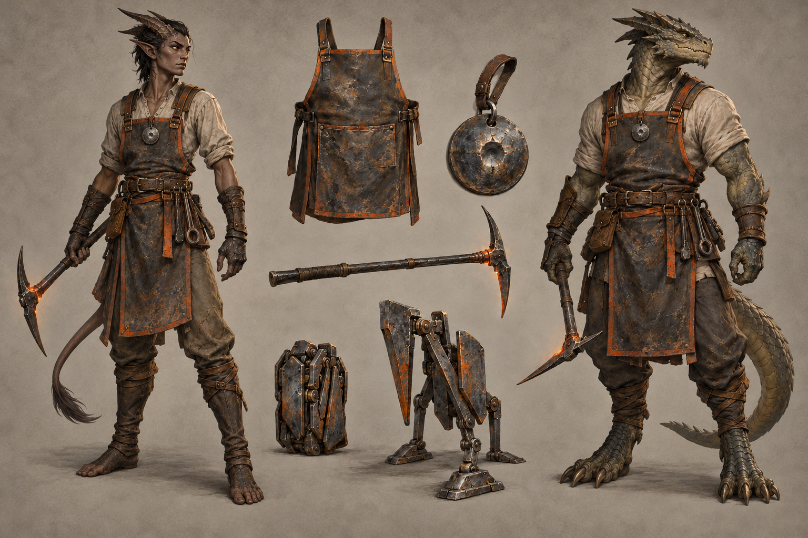

# Flamebinder identity sheet — draft for owner review

Batch: item 28 (b), 2026-10-31. U1 / issue #537. This sheet replaces nothing and establishes no canon.

## Bible Open line and kit contract

Part III has **no class-kit Open line** to quote; its race Open paragraphs appear exactly once, in the seven race sidecars. The kit-specific review questions below are proposals under [handoff §4.2](../../../../../docs/handoff-art-units-codex.md), not invented bible quotations.

> A kit is a mesh set that attaches to any race base: weapon(s), one regalia piece, one mark or
> accessory. Kits never change the body.

Canon kit from [class_catalog.gd](../../../../../globals/stats/class_catalog.gd):

> War pick, deployable kinetic-sculpture constructs.

## Proposed answers

- Proposes: a soot-blackened war pick and compact folding kinetic-sculpture emplacement with simple hinged plates. **Review item:** weapon and construct presentation.
- Proposes: a heavy forge apron with a small copper-orange cloth edge. **Review item:** regalia piece.
- Proposes: a heat-tempered steel token retaining an imperfect test indentation. **Review item:** mark or accessory.

## Fixed facts honoured

Canon kit: War pick, deployable kinetic-sculpture constructs. Palette: Copper Orange / Steel Gray, muted oxidized orange and soot-grey. These are ordinary healthy mortal kes-reth and orthos wearers; the kit does not authorize changes to race anatomy. Kes'reth has horns and living heat-blood tissue, with no Mirror-Veil body. Orthos is draconic and wingless.

One regalia assembly and one identifying mark/accessory are proposed. Canon auxiliary instruments and tools are equipment, not additional patron regalia. The [style guide](../../../../../design/god-aesthetic-style-guide.md) supplies material language; only handoff §4.2 supplies faction colours. No text is permitted in this image.

## Known weaknesses

- The correction shows the token on both wearers and makes Kes'reth horns sweep back, but their length still differs from the race sheet.
- The deployed construct's four legs can suggest locomotion; this drawing proposes an immobile emplacement silhouette only, not walking, attacks or new behavior.
- Pick-head heat and copper-orange apron edges are stronger than some neighboring kits; saturation and active heat remain review points.

## Provenance and review

- Race bases: **kes-reth / orthos**, left / right.
- Full-resolution PNG: 1536 × 1024; copied byte-for-byte from the generator, never downscaled or retouched.
- Generations used: 2 / 2; retained attempt 2.
- Full prompt, source path, timestamp and SHA-256: [provenance.json](provenance.json).
- Owner review and complete ruling list: [U1 contact sheet](../../../../../docs/qa/identity-sheets-2026-10-31/README.md).
