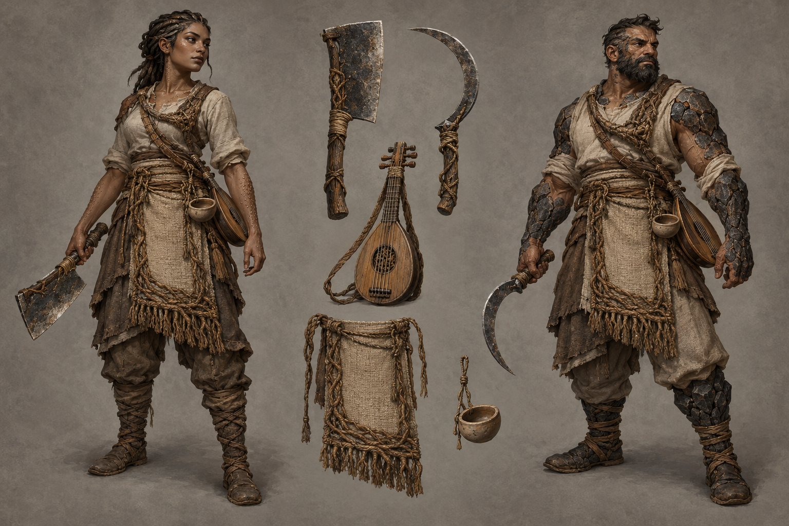

# Husk-bearer identity sheet — draft for owner review

Batch: item 28 (b), 2026-10-31. U1 / issue #537. This sheet replaces nothing and establishes no canon.

## Bible Open line and kit contract

Part III has **no class-kit Open line** to quote; its race Open paragraphs appear exactly once, in the seven race sidecars. The kit-specific review questions below are proposals under [handoff §4.2](../../../../../docs/handoff-art-units-codex.md), not invented bible quotations.

> A kit is a mesh set that attaches to any race base: weapon(s), one regalia piece, one mark or
> accessory. Kits never change the body.

Canon kit from [class_catalog.gd](../../../../../globals/stats/class_catalog.gd):

> Cleaver or sickle, gut-lute.

## Proposed answers

- Proposes: a rooted-wood-handled cleaver and simple sickle alternatives, with a gut-strung lute. **Review item:** weapon and tool presentation.
- Proposes: one carefully woven plant-fibre service apron with pruned root-bound edging. **Review item:** regalia piece.
- Proposes: a matte ceramic empty-bowl token carried at the apron tie. **Review item:** mark or accessory.

## Fixed facts honoured

Canon kit: Cleaver or sickle, gut-lute. Palette: None in canon; root-bound wood, undyed woven fibre, matte unglazed clay and worked iron only. These are ordinary healthy mortal weftkin and kaan wearers; the kit does not authorize changes to race anatomy.

One regalia assembly and one identifying mark/accessory are proposed. Canon auxiliary instruments and tools are equipment, not additional patron regalia. The [style guide](../../../../../design/god-aesthetic-style-guide.md) supplies material language; only handoff §4.2 supplies faction colours. No text is permitted in this image.

## Known weaknesses

- The empty-bowl token reads as a small usable bowl; the owner should rule on its size rather than infer a new ritual.
- Root edging can read as ordinary cord. The lute's gut-string material cannot be established from a still image.

## Provenance and review

- Race bases: **weftkin / kaan**, left / right.
- Full-resolution PNG: 1536 × 1024; copied byte-for-byte from the generator, never downscaled or retouched.
- Generations used: 1 / 2; retained attempt 1.
- Full prompt, source path, timestamp and SHA-256: [provenance.json](provenance.json).
- Owner review and complete ruling list: [U1 contact sheet](../../../../../docs/qa/identity-sheets-2026-10-31/README.md).
