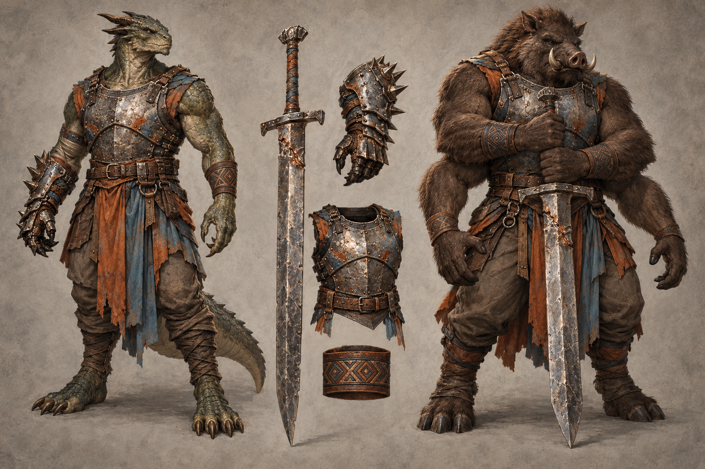

# Ironbrand identity sheet — draft for owner review

Batch: item 28 (b), 2026-10-31. U1 / issue #537. This sheet replaces nothing and establishes no canon.

## Bible Open line and kit contract

Part III has **no class-kit Open line** to quote; its race Open paragraphs appear exactly once, in the seven race sidecars. The kit-specific review questions below are proposals under [handoff §4.2](../../../../../docs/handoff-art-units-codex.md), not invented bible quotations.

> A kit is a mesh set that attaches to any race base: weapon(s), one regalia piece, one mark or
> accessory. Kits never change the body.

Canon kit from [class_catalog.gd](../../../../../globals/stats/class_catalog.gd):

> Greatsword or spiked gauntlet, ritual branding.

## Proposed answers

- Proposes: greatsword with a visible rejoined steel seam, plus spiked gauntlet as the alternative loadout. **Review item:** weapon presentation.
- Proposes: a load-bearing riveted breastplate with repaired welds and small rust-orange and dusty-blue cloth insets. **Review item:** regalia piece.
- Proposes: a counted geometric brand register on a leather forearm band. **Review item:** mark or accessory.
- Proposes: upper pair grips the greatsword; lower pair stays empty and visible. **Review item:** Ghorr weapon arm pair.

## Fixed facts honoured

Canon kit: Greatsword or spiked gauntlet, ritual branding. Palette: Sunset Orange / Robin's Egg Blue, muted rust-orange and dusty blue-grey. These are ordinary healthy mortal orthos and ghorr wearers; the kit does not authorize changes to race anatomy. Ghorr keeps four arms, an almost ursine body and a warthog-like face; the upper/lower attachment rule remains a proposal. Orthos is draconic and wingless.

One regalia assembly and one identifying mark/accessory are proposed. Canon auxiliary instruments and tools are equipment, not additional patron regalia. The [style guide](../../../../../design/god-aesthetic-style-guide.md) supplies material language; only handoff §4.2 supplies faction colours. No text is permitted in this image.

## Known weaknesses

- The ritual-brand register is readable as ornament, but counting and symbolic meaning are deliberately unspecified.
- The wrist bands repeat on multiple Ghorr arms, and the breastplate includes attached cloth panels; these remain one mark family and one regalia assembly, not new mechanics.

## Provenance and review

- Race bases: **orthos / ghorr**, left / right.
- Full-resolution PNG: 1536 × 1024; copied byte-for-byte from the generator, never downscaled or retouched.
- Generations used: 1 / 2; retained attempt 1.
- Full prompt, source path, timestamp and SHA-256: [provenance.json](provenance.json).
- Owner review and complete ruling list: [U1 contact sheet](../../../../../docs/qa/identity-sheets-2026-10-31/README.md).
