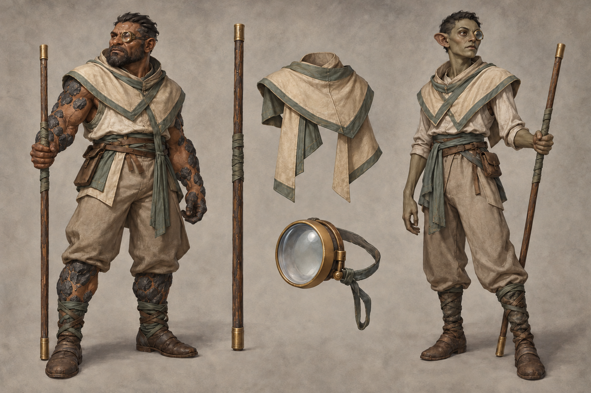

# Lensbearer identity sheet — draft for owner review

Batch: item 28 (b), 2026-10-31. U1 / issue #537. This sheet replaces nothing and establishes no canon.

## Bible Open line and kit contract

Part III has **no class-kit Open line** to quote; its race Open paragraphs appear exactly once, in the seven race sidecars. The kit-specific review questions below are proposals under [handoff §4.2](../../../../../docs/handoff-art-units-codex.md), not invented bible quotations.

> A kit is a mesh set that attaches to any race base: weapon(s), one regalia piece, one mark or
> accessory. Kits never change the body.

Canon kit from [class_catalog.gd](../../../../../globals/stats/class_catalog.gd):

> Quarterstaff, precision monocle.

## Proposed answers

- Proposes: a plain hardwood quarterstaff with small dull brass ferrules. **Review item:** weapon presentation.
- Proposes: a fitted parchment-beige shoulder mantle edged in muted seafoam cloth. **Review item:** regalia piece.
- Proposes: a precision-ground monocle with one small functional dull-brass hinge. **Review item:** mark or accessory.

## Fixed facts honoured

Canon kit: Quarterstaff, precision monocle. Palette: Seafoam Green / Parchment Beige, desaturated grey-green and aged beige. These are ordinary healthy mortal kaan and vaerin wearers; the kit does not authorize changes to race anatomy.

One regalia assembly and one identifying mark/accessory are proposed. Canon auxiliary instruments and tools are equipment, not additional patron regalia. The [style guide](../../../../../design/god-aesthetic-style-guide.md) supplies material language; only handoff §4.2 supplies faction colours. No text is permitted in this image.

## Known weaknesses

- The second attempt removed inscription-like marks from the monocle. Brass is brighter than the dull-material brief and may need less polish.
- The Vaerin head proportions and ears vary from the race sheet; the race identity sheet remains the base proposal. Monocle fit at the eye is not a tested attachment.

## Provenance and review

- Race bases: **kaan / vaerin**, left / right.
- Full-resolution PNG: 1536 × 1024; copied byte-for-byte from the generator, never downscaled or retouched.
- Generations used: 2 / 2; retained attempt 2.
- Full prompt, source path, timestamp and SHA-256: [provenance.json](provenance.json).
- Owner review and complete ruling list: [U1 contact sheet](../../../../../docs/qa/identity-sheets-2026-10-31/README.md).
