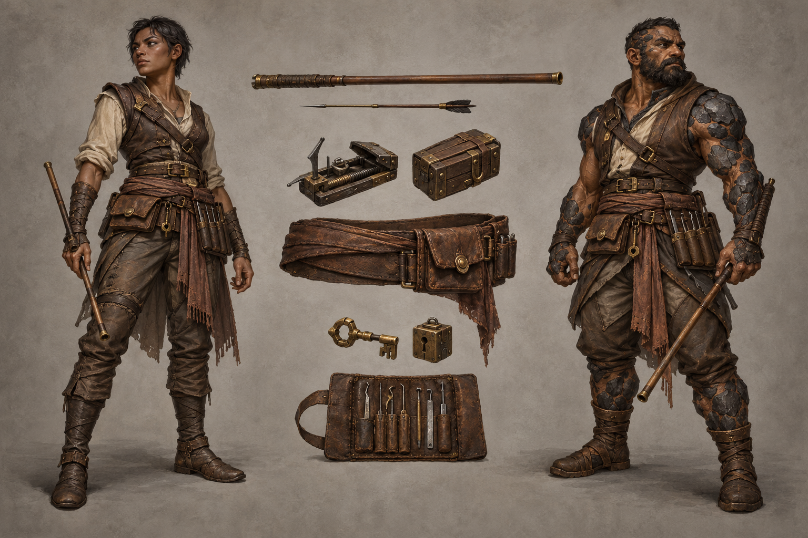

# Locksmirk identity sheet — draft for owner review

Batch: item 28 (b), 2026-10-31. U1 / issue #537. This sheet replaces nothing and establishes no canon.

## Bible Open line and kit contract

Part III has **no class-kit Open line** to quote; its race Open paragraphs appear exactly once, in the seven race sidecars. The kit-specific review questions below are proposals under [handoff §4.2](../../../../../docs/handoff-art-units-codex.md), not invented bible quotations.

> A kit is a mesh set that attaches to any race base: weapon(s), one regalia piece, one mark or
> accessory. Kits never change the body.

Canon kit from [class_catalog.gd](../../../../../globals/stats/class_catalog.gd):

> Blowgun, trap poetry, lockpicking-as-combat.

## Proposed answers

- Proposes: a narrow plain wood blowgun, a pocket-sized spring trap and small worn lockpicks. **Review item:** weapon and tool presentation.
- Proposes: one practical worn-leather tool sash with discreet false-front pocket. **Review item:** regalia piece.
- Proposes: a mismatched key-and-lock token worn at the sash. **Review item:** mark or accessory.

## Fixed facts honoured

Canon kit: Blowgun, trap poetry, lockpicking-as-combat. Palette: None in canon; worn leather, dull miniature brass, worked steel and plain wood only. These are ordinary healthy mortal vael and kaan wearers; the kit does not authorize changes to race anatomy.

One regalia assembly and one identifying mark/accessory are proposed. Canon auxiliary instruments and tools are equipment, not additional patron regalia. The [style guide](../../../../../design/god-aesthetic-style-guide.md) supplies material language; only handoff §4.2 supplies faction colours. No text is permitted in this image.

## Known weaknesses

- The depicted pocket mechanism is a visual prop, not a construction diagram or a newly specified trap effect.
- False-front pocket and key mismatch are not fully demonstrable in one view. No faction colour has been assigned.

## Provenance and review

- Race bases: **vael / kaan**, left / right.
- Full-resolution PNG: 1536 × 1024; copied byte-for-byte from the generator, never downscaled or retouched.
- Generations used: 1 / 2; retained attempt 1.
- Full prompt, source path, timestamp and SHA-256: [provenance.json](provenance.json).
- Owner review and complete ruling list: [U1 contact sheet](../../../../../docs/qa/identity-sheets-2026-10-31/README.md).
