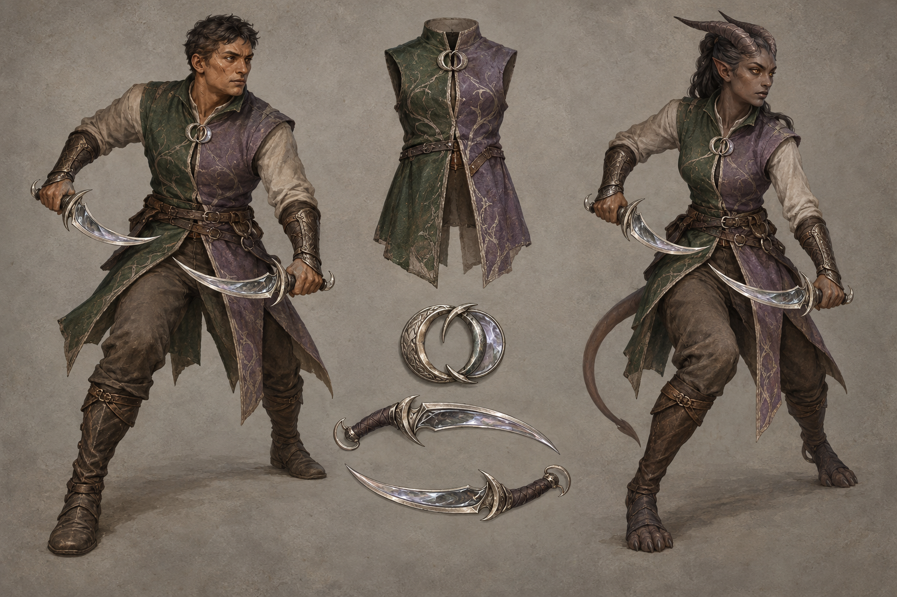

# Mirrorblade identity sheet — draft for owner review

Batch: item 28 (b), 2026-10-31. U1 / issue #537. This sheet replaces nothing and establishes no canon.

## Bible Open line and kit contract

Part III has **no class-kit Open line** to quote; its race Open paragraphs appear exactly once, in the seven race sidecars. The kit-specific review questions below are proposals under [handoff §4.2](../../../../../docs/handoff-art-units-codex.md), not invented bible quotations.

> A kit is a mesh set that attaches to any race base: weapon(s), one regalia piece, one mark or
> accessory. Kits never change the body.

Canon kit from [class_catalog.gd](../../../../../globals/stats/class_catalog.gd):

> Paired balanced daggers, Mirrorwalking footwork.

## Proposed answers

- Proposes: equal balanced crescent daggers in cold mirror-ground steel with dark wrapped grips. **Review item:** weapon presentation.
- Proposes: a bilateral short forest-green and dusty-lilac duelist tabard with one interrupted silver seam. **Review item:** regalia piece.
- Proposes: a silver paired-crescent ring clasp with offset reflective surfaces. **Review item:** mark or accessory.

## Fixed facts honoured

Canon kit: Paired balanced daggers, Mirrorwalking footwork. Palette: Forest Green / Lilac, muted to moss green and dusty grey-lilac. These are ordinary healthy mortal vael and kes-reth wearers; the kit does not authorize changes to race anatomy. Kes'reth has horns and living heat-blood tissue, with no Mirror-Veil body.

One regalia assembly and one identifying mark/accessory are proposed. Canon auxiliary instruments and tools are equipment, not additional patron regalia. The [style guide](../../../../../design/god-aesthetic-style-guide.md) supplies material language; only handoff §4.2 supplies faction colours. No text is permitted in this image.

## Known weaknesses

- Daggers and bracers are more ornate than the plain working proposal; the tabard also carries more decorative surface detail than the brief requested.
- Delayed reflection and the one broken seam cannot be read reliably at thumbnail size. The kit sheet is not authority to change Kes'reth anatomy or feet.

## Provenance and review

- Race bases: **vael / kes-reth**, left / right.
- Full-resolution PNG: 1536 × 1024; copied byte-for-byte from the generator, never downscaled or retouched.
- Generations used: 1 / 2; retained attempt 1.
- Full prompt, source path, timestamp and SHA-256: [provenance.json](provenance.json).
- Owner review and complete ruling list: [U1 contact sheet](../../../../../docs/qa/identity-sheets-2026-10-31/README.md).
