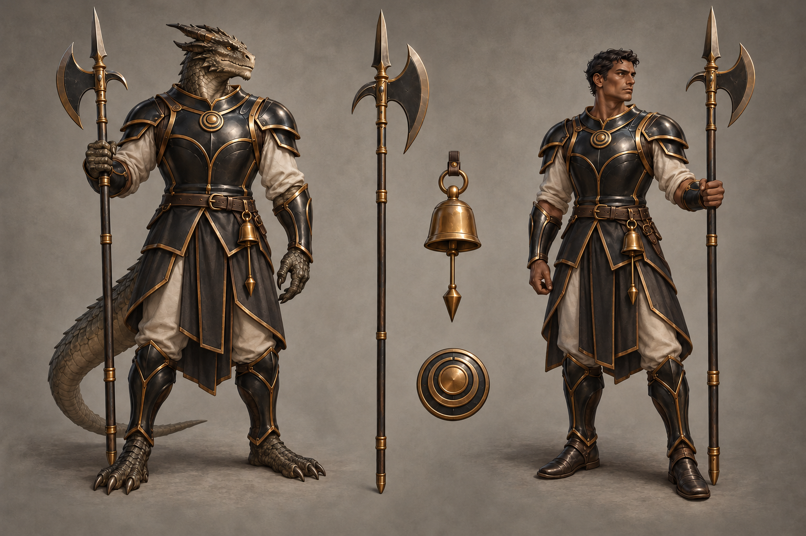

# Oathclock identity sheet — draft for owner review

Batch: item 28 (b), 2026-10-31. U1 / issue #537. This sheet replaces nothing and establishes no canon.

## Bible Open line and kit contract

Part III has **no class-kit Open line** to quote; its race Open paragraphs appear exactly once, in the seven race sidecars. The kit-specific review questions below are proposals under [handoff §4.2](../../../../../docs/handoff-art-units-codex.md), not invented bible quotations.

> A kit is a mesh set that attaches to any race base: weapon(s), one regalia piece, one mark or
> accessory. Kits never change the body.

Canon kit from [class_catalog.gd](../../../../../globals/stats/class_catalog.gd):

> Halberd, pendulum bell — a metronome weapon doubling as a Song-timing tool.

## Proposed answers

- Proposes: an immaculate straight halberd and small visible pendulum bell on a plain suspension. **Review item:** weapon and tool presentation.
- Proposes: one perfectly maintained symmetric ash-black lacquered cuirass with bronze margins. **Review item:** regalia piece.
- Proposes: a small bronze concentric-ring badge without numbered graduations. **Review item:** mark or accessory.

## Fixed facts honoured

Canon kit: Halberd, pendulum bell — a metronome weapon doubling as a Song-timing tool. Palette: Ash Black / Bronze, warm charcoal-black lacquer and restrained bronze. These are ordinary healthy mortal orthos and vael wearers; the kit does not authorize changes to race anatomy. Orthos is draconic and wingless. Pazzah's erased notch remains unexplained; no symbol on the sheet supplies its meaning.

One regalia assembly and one identifying mark/accessory are proposed. Canon auxiliary instruments and tools are equipment, not additional patron regalia. The [style guide](../../../../../design/god-aesthetic-style-guide.md) supplies material language; only handoff §4.2 supplies faction colours. No text is permitted in this image.

## Known weaknesses

- The second attempt polished the kit, but the badge close-up retains a tiny dark junction between ring highlights. It has no assigned lore meaning and does not explain or reconstruct the erased notch.
- The generator extends the cuirass into matching arm and leg protection. Treat that extra coverage as incidental draft dressing; the proposed regalia piece is the cuirass.
- The polished surfaces approach a cleaner rendering finish than the other kits; the owner should judge whether the patron-specific refinement remains inside the painted house style.

## Provenance and review

- Race bases: **orthos / vael**, left / right.
- Full-resolution PNG: 1536 × 1024; copied byte-for-byte from the generator, never downscaled or retouched.
- Generations used: 2 / 2; retained attempt 2.
- Full prompt, source path, timestamp and SHA-256: [provenance.json](provenance.json).
- Owner review and complete ruling list: [U1 contact sheet](../../../../../docs/qa/identity-sheets-2026-10-31/README.md).
