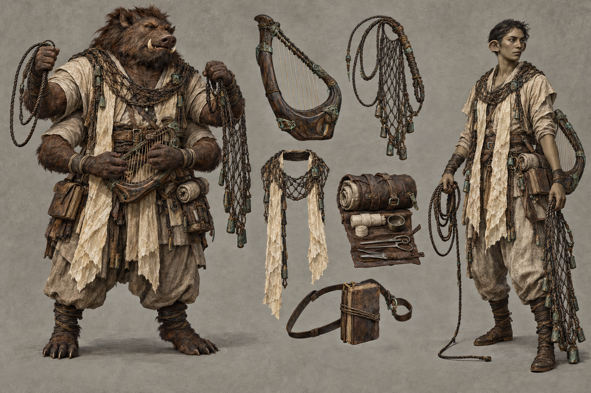

# River-Mother identity sheet — draft for owner review

Batch: item 28 (b), 2026-10-31. U1 / issue #537. This sheet replaces nothing and establishes no canon.

## Bible Open line and kit contract

Part III has **no class-kit Open line** to quote; its race Open paragraphs appear exactly once, in the seven race sidecars. The kit-specific review questions below are proposals under [handoff §4.2](../../../../../docs/handoff-art-units-codex.md), not invented bible quotations.

> A kit is a mesh set that attaches to any race base: weapon(s), one regalia piece, one mark or
> accessory. Kits never change the body.

Canon kit from [class_catalog.gd](../../../../../globals/stats/class_catalog.gd):

> Water harp, net-and-whip, hospice tools doubling as battlefield medicine.

## Proposed answers

- Proposes: a tarred net-and-whip, swollen-wood water harp and compact hospice-tool roll. **Review item:** weapon and tool presentation.
- Proposes: a narrow salt-stiffened net stole with long wet-vellum registers. **Review item:** regalia piece.
- Proposes: a closed cockled Name-Ledger on a plain waist sling, without lettering. **Review item:** mark or accessory.
- Proposes: upper pair handles net and whip; lower pair supports the water harp. **Review item:** Ghorr weapon arm pair.

## Fixed facts honoured

Canon kit: Water harp, net-and-whip, hospice tools doubling as battlefield medicine. Palette: None in canon; undyed vellum, tarred cordage, weathered wood, worn leather and tiny dull verdigris fittings only. These are ordinary healthy mortal ghorr and vaerin wearers; the kit does not authorize changes to race anatomy. Ghorr keeps four arms, an almost ursine body and a warthog-like face; the upper/lower attachment rule remains a proposal.

One regalia assembly and one identifying mark/accessory are proposed. Canon auxiliary instruments and tools are equipment, not additional patron regalia. The [style guide](../../../../../design/god-aesthetic-style-guide.md) supplies material language; only handoff §4.2 supplies faction colours. No text is permitted in this image.

## Known weaknesses

- The wet-vellum stole risks reading as torn fabric; wetness and reused paper need a material study.
- Harp strings, net strands and the lower Ghorr hand contacts overlap in places; four arms remain visible, but attachment clearance is not a rigging proof.

## Provenance and review

- Race bases: **ghorr / vaerin**, left / right.
- Full-resolution PNG: 1536 × 1024; copied byte-for-byte from the generator, never downscaled or retouched.
- Generations used: 1 / 2; retained attempt 1.
- Full prompt, source path, timestamp and SHA-256: [provenance.json](provenance.json).
- Owner review and complete ruling list: [U1 contact sheet](../../../../../docs/qa/identity-sheets-2026-10-31/README.md).
