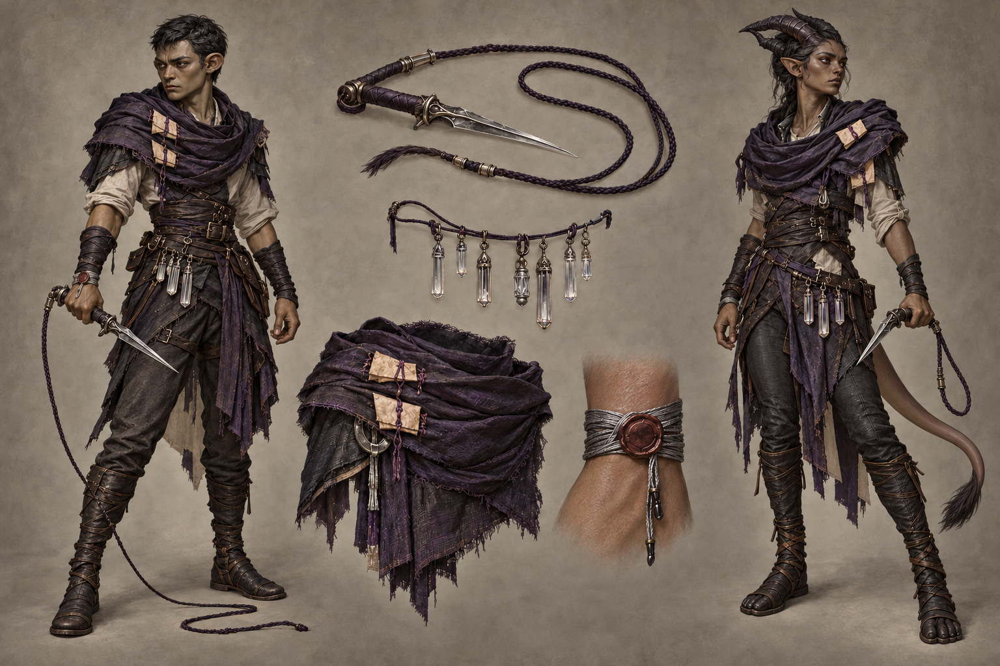

# Threadwalker identity sheet — draft for owner review

Batch: item 28 (b), 2026-10-31. U1 / issue #537. This sheet replaces nothing and establishes no canon.

## Bible Open line and kit contract

Part III has **no class-kit Open line** to quote; its race Open paragraphs appear exactly once, in the seven race sidecars. The kit-specific review questions below are proposals under [handoff §4.2](../../../../../docs/handoff-art-units-codex.md), not invented bible quotations.

> A kit is a mesh set that attaches to any race base: weapon(s), one regalia piece, one mark or
> accessory. Kits never change the body.

Canon kit from [class_catalog.gd](../../../../../globals/stats/class_catalog.gd):

> Whip-dagger, glass chimes that passively reveal enemy resource pools.

## Proposed answers

- Proposes: a dagger attached to a taut fine-cord whip with a small set of clear glass chimes. **Review item:** weapon and tool presentation.
- Proposes: one dry matte violet-black notarial shoulder wrap with sewn-closed parchment slips. **Review item:** regalia piece.
- Proposes: a silver-thread wrist binding secured by a plain wax seal. **Review item:** mark or accessory.

## Fixed facts honoured

Canon kit: Whip-dagger, glass chimes that passively reveal enemy resource pools. Palette: Violet-Black / Thread-Silver, near-charcoal muted violet and restrained silver. These are ordinary healthy mortal vaerin and kes-reth wearers; the kit does not authorize changes to race anatomy. Kes'reth has horns and living heat-blood tissue, with no Mirror-Veil body.

One regalia assembly and one identifying mark/accessory are proposed. Canon auxiliary instruments and tools are equipment, not additional patron regalia. The [style guide](../../../../../design/god-aesthetic-style-guide.md) supplies material language; only handoff §4.2 supplies faction colours. No text is permitted in this image.

## Known weaknesses

- The second attempt corrected the left Vaerin's pointed ears and the right Kes'reth's hoof-like footwear, but facial proportions still drift from the race sheet.
- The wrist accessory is more heavily wrapped than a single fine thread, and the wax-seal attachment is clearest in the close-up rather than on both bodies.
- Whip tension relaxes in the object study; the sheet does not define an attack animation or a new resource display.

## Provenance and review

- Race bases: **vaerin / kes-reth**, left / right.
- Full-resolution PNG: 1536 × 1024; copied byte-for-byte from the generator, never downscaled or retouched.
- Generations used: 2 / 2; retained attempt 2.
- Full prompt, source path, timestamp and SHA-256: [provenance.json](provenance.json).
- Owner review and complete ruling list: [U1 contact sheet](../../../../../docs/qa/identity-sheets-2026-10-31/README.md).
