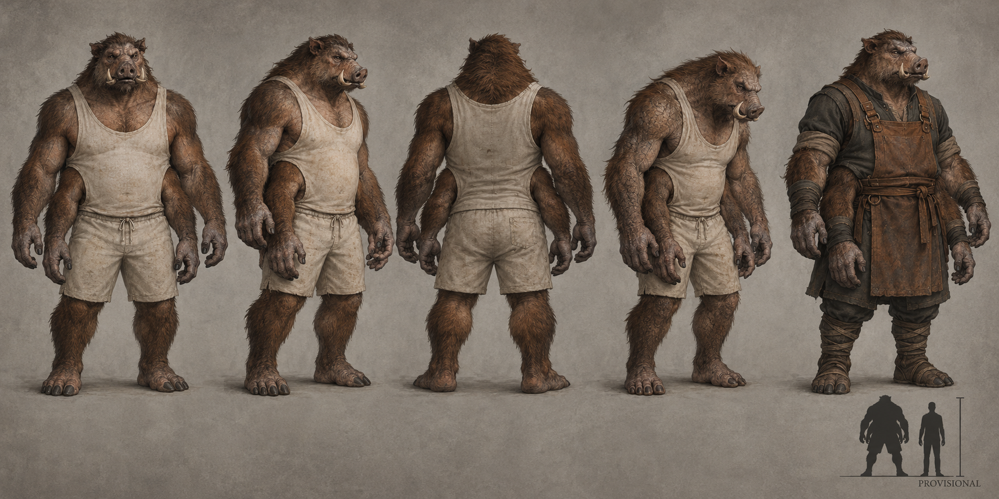

# Ghorr identity sheet — draft for owner review

Batch: item 28 (b), 2026-10-31. U1 / issue #537. This sheet replaces nothing and establishes no canon.

## Bible Open line

Source: [art-aesthetics-bible.md, Part III](../../../../../docs/art-aesthetics-bible.md).

> **Open:** placement and relative size of the two arm pairs, hand anatomy, fur coverage,
> snout and tusks, leg posture, relative scale, and surface palette. The warthog reference
> does not yet fix a particular tusk pattern. Brittle decline is a separate state from
> the healthy body's capacity to carry weight.

## Proposed answers

- Proposes: upper shoulders wide at collar level, a second pair below the ribs angled slightly forward; lower arms about four-fifths the upper pair's length. **Open item:** placement and relative size of the two arm pairs.
- Proposes: four thick fingers and one opposable thumb on each of four broad padded hands. **Open item:** hand anatomy.
- Proposes: coarse short fur on back, shoulders and outer limbs, with sparse chest and exposed palms and muzzle. **Open item:** fur coverage.
- Proposes: broad flattened warthog-like muzzle with one modest upward-curving lower tusk on each side. **Open item:** snout and tusks.
- Proposes: broad plantigrade feet and bent load-bearing knees under a barrel torso. **Open item:** leg posture.
- Proposes: 1.15 times the Vael adult, PROVISIONAL. **Open item:** relative scale.
- Proposes: peat-brown fur, grey-brown hide and worn-ivory tusks. **Open item:** surface palette.

## Fixed facts honoured

Exactly four arms in every study; almost ursine body; warthog-like face; Waning is heavy and brittle, distinct from healthy weight-bearing capacity.

Front, three-quarter and back healthy turnaround; fourth study is Waning-touched; fifth is a Dom worker with no class kit. The neutral worker clothing is a local dressing study, not a new company uniform or population ruling. The scale bar requests **1.15× Vael**, PROVISIONAL, with no runtime change. The only permitted image text is PROVISIONAL.

## Known weaknesses

- The four arms are visible, but shoulder attachment and lower-hand size vary slightly between views; the claimed five-digit hand anatomy needs a modeling study.
- The scale inset approximates 1.15 rather than measuring it precisely. Heavy/brittle decline is clearest at the shoulder; other stress surfaces remain understated.

## Provenance and review

- Full-resolution PNG: 1774 × 887; copied byte-for-byte from the generator, never downscaled or retouched.
- Generations used: 1 / 2; retained attempt 1.
- Full prompt, source path, timestamp and SHA-256: [provenance.json](provenance.json).
- Owner review and complete ruling list: [U1 contact sheet](../../../../../docs/qa/identity-sheets-2026-10-31/README.md).
