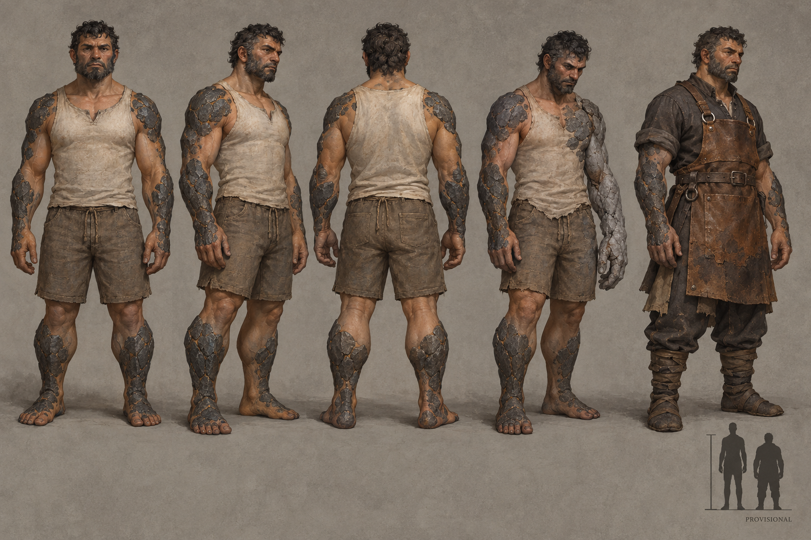

# Kaan identity sheet — draft for owner review

Batch: item 28 (b), 2026-10-31. U1 / issue #537. This sheet replaces nothing and establishes no canon.

## Bible Open line

Source: [art-aesthetics-bible.md, Part III](../../../../../docs/art-aesthetics-bible.md).

> **Open:** body proportions, mineral coverage and type, exposed flesh, hair/beard
> structure, joint behavior, and the progression from healthy body to inert stone.
> Specific minerals and an almost entirely stone body remain design choices.

## Proposed answers

- Proposes: compact broad torso, short sturdy lower legs and long working forearms. **Open item:** body proportions.
- Proposes: irregular dark basalt-like plates over shoulders, forearms and shins, leaving most joints mobile. **Open item:** mineral coverage and type.
- Proposes: warm umber living tissue at face, palms and flexion folds. **Open item:** exposed flesh.
- Proposes: coarse short dark hair and beard with sparse grey grit; mineral threading remains weakly resolved. **Open item:** hair/beard structure.
- Proposes: supple skin folds between mineral plates, with ordinary bending in healthy wrists and knees. **Open item:** joint behavior.
- Proposes: left hand and forearm close into continuous stone first, with mineral spreading through joints toward a fully settled body. **Open item:** progression from healthy body to inert stone.

## Fixed facts honoured

Stone-fused, part-mineral living people; the settling ends in inert, non-sentient rock. Fungal growth does not replace the stone identity.

Front, three-quarter and back healthy turnaround; fourth study is Waning-touched; fifth is a Dom worker with no class kit. The neutral worker clothing is a local dressing study, not a new company uniform or population ruling. The scale bar requests **0.9× Vael**, PROVISIONAL, with no runtime change. The only permitted image text is PROVISIONAL.

## Known weaknesses

- Mineral granules in hair and beard are not clearly resolved; the visible proposal remains coarse short hair/beard with sparse grey grit.
- On the Waning figure mineral and shirt edges overlap at the chest. The inset is approximate; the requested height factor is 0.9.
- The progression ends at a partly settled living stage rather than a fully inert endpoint.

## Provenance and review

- Full-resolution PNG: 1536 × 1024; copied byte-for-byte from the generator, never downscaled or retouched.
- Generations used: 1 / 2; retained attempt 1.
- Full prompt, source path, timestamp and SHA-256: [provenance.json](provenance.json).
- Owner review and complete ruling list: [U1 contact sheet](../../../../../docs/qa/identity-sheets-2026-10-31/README.md).
