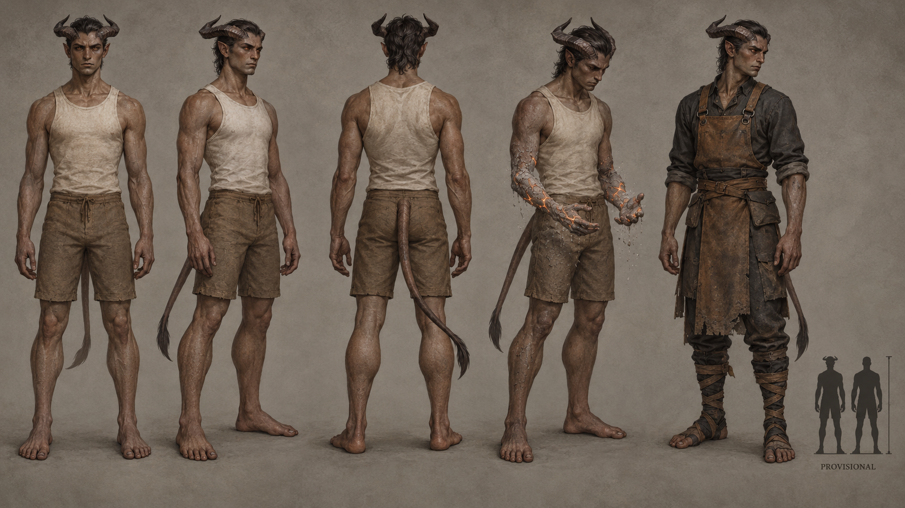

# Kes'reth identity sheet — draft for owner review

Batch: item 28 (b), 2026-10-31. U1 / issue #537. This sheet replaces nothing and establishes no canon.

## Bible Open line

Source: [art-aesthetics-bible.md, Part III](../../../../../docs/art-aesthetics-bible.md).

> **Open:** horn arrangement, face, build, skin and ash palette, tail/feet anatomy, and
> the healthy-to-combusting transition. The older ash-to-red skin range is historical
> reference, not a newly confirmed restriction.

## Proposed answers

- Proposes: two ridged horns growing above the temples and sweeping backward then slightly upward. **Open item:** horn arrangement.
- Proposes: high cheek planes, broad low nose and deep-set eyes with restrained heat at the inner corners. **Open item:** face.
- Proposes: lean durable torso and sinewy limbs with controlled upright bearing. **Open item:** build.
- Proposes: warm umber-grey skin, charcoal horns, cool pale ash and tiny ember-orange fissures. **Open item:** skin and ash palette.
- Proposes: one lean tapering tail with a dark terminal tassel and plantigrade five-toed feet. **Open item:** tail/feet anatomy.
- Proposes: cool ash gathers along hands and forearms as tiny ember seams consume surface tissue slowly, without whole-body flames. **Open item:** healthy-to-combusting transition.

## Fixed facts honoured

Horned, heat-blood Ashborn; clinical heat becomes slow ashen combustion. Mirror-Veil is dropped: no mirror-bodied anatomy, reflective branch or paired mirror scars.

Front, three-quarter and back healthy turnaround; fourth study is Waning-touched; fifth is a Dom worker with no class kit. The neutral worker clothing is a local dressing study, not a new company uniform or population ruling. The scale bar requests **1× Vael**, PROVISIONAL, with no runtime change. The only permitted image text is PROVISIONAL.

## Known weaknesses

- The generated tail ends in a dark tassel, and horn spread varies slightly across views; those tail/horn details are draft anatomy only.
- Ash fractures risk reading as lava-like stone at thumbnail size; the scene depicts local slow combustion, not a healthy burning body.
- Inset height is approximate and counts horn tips; the proposed body-height factor is 1.0.

## Provenance and review

- Full-resolution PNG: 1672 × 941; copied byte-for-byte from the generator, never downscaled or retouched.
- Generations used: 1 / 2; retained attempt 1.
- Full prompt, source path, timestamp and SHA-256: [provenance.json](provenance.json).
- Owner review and complete ruling list: [U1 contact sheet](../../../../../docs/qa/identity-sheets-2026-10-31/README.md).
