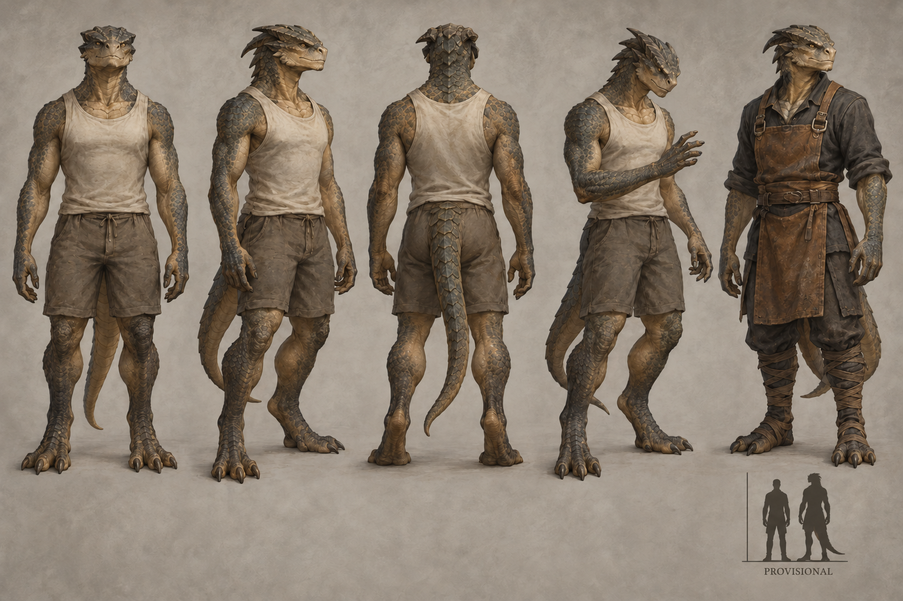

# Orthos identity sheet — draft for owner review

Batch: item 28 (b), 2026-10-31. U1 / issue #537. This sheet replaces nothing and establishes no canon.

## Bible Open line

Source: [art-aesthetics-bible.md, Part III](../../../../../docs/art-aesthetics-bible.md).

> **Open:** head and muzzle, scales or other surface, horns, tail, limb proportions,
> and how strongly draconic the body reads. Wings and flight are not established by
> the label. Temporal drift is a condition, not a requirement for a permanently distorted mesh.

## Proposed answers

- Proposes: broad wedge head with a short blunt muzzle, offset stepped brow plates and lateral nostrils. **Open item:** head and muzzle.
- Proposes: small interlocking slate-olive scales with broad throat plates. **Open item:** scales or other surface.
- Proposes: low swept-back horn ridges within a layered head crest. **Open item:** horns.
- Proposes: one muscular tapering balancing tail, held low. **Open item:** tail.
- Proposes: long forearms, robust thighs, low raised heels and broad feet with four visible foretoes. **Open item:** limb proportions.
- Proposes: clearly draconic head, hide, hands, feet and tail, while upright and wingless. **Open item:** how strongly draconic the body reads.

## Fixed facts honoured

Puer's Witnesses; distinctly Dramgid draconic humanoids, no wings. Left-right double-tap and six-minute temporal loops are carried by bearing; no machinery or permanently distorted body.

Front, three-quarter and back healthy turnaround; fourth study is Waning-touched; fifth is a Dom worker with no class kit. The neutral worker clothing is a local dressing study, not a new company uniform or population ruling. The scale bar requests **1.1× Vael**, PROVISIONAL, with no runtime change. The only permitted image text is PROVISIONAL.

## Known weaknesses

- The generator produced broader horn/crest clusters and four visible foretoes rather than the prompt's two simple horn ridges and three-toed feet; the visible crest and four-toed proposal is what the owner is reviewing.
- Temporal drift can read as an arrested inspection gesture; a static sheet cannot prove a six-minute loop.
- The second attempt enlarged the scale inset toward the requested 1.1 factor, but it remains an approximate illustration; do not derive production height from its pixels.

## Provenance and review

- Full-resolution PNG: 1536 × 1024; copied byte-for-byte from the generator, never downscaled or retouched.
- Generations used: 2 / 2; retained attempt 2.
- Full prompt, source path, timestamp and SHA-256: [provenance.json](provenance.json).
- Owner review and complete ruling list: [U1 contact sheet](../../../../../docs/qa/identity-sheets-2026-10-31/README.md).
