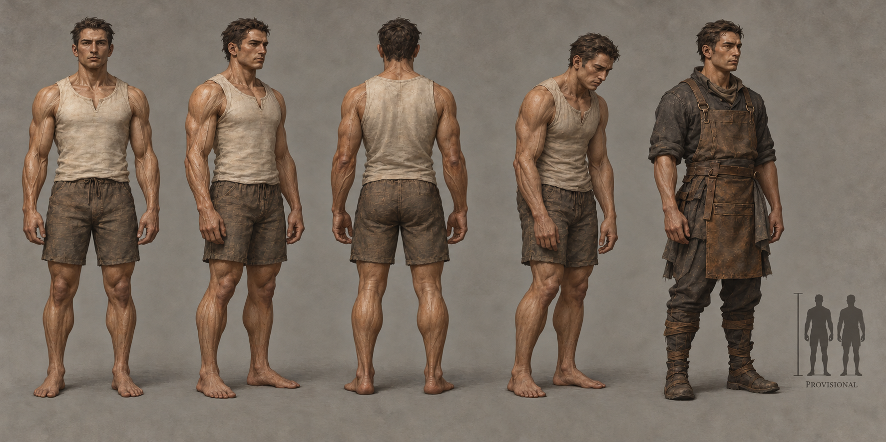

# Vael identity sheet — draft for owner review

Batch: item 28 (b), 2026-10-31. U1 / issue #537. This sheet replaces nothing and establishes no canon.

## Bible Open line

Source: [art-aesthetics-bible.md, Part III](../../../../../docs/art-aesthetics-bible.md).

> **Open:** silhouette, bodily substrate, facial structure, proportions, surface palette,
> and how loss of rigidity reads on a living person. The acoustic B-flat has no assigned
> color. Solmarch's association with Hard Certainty can inform culture without settling biology.

## Proposed answers

- Proposes: upright, gently squared shoulders and a controlled vertical stance. **Open item:** silhouette.
- Proposes: living matte tissue held in broad fibrous tension planes, a draft surface hypothesis rather than fixed canon. **Open item:** bodily substrate.
- Proposes: broad planar brow and cheek planes, shallow temples, compact rounded ears. **Open item:** facial structure.
- Proposes: approximately seven-and-a-half heads with moderate limbs and baseline breadth. **Open item:** proportions.
- Proposes: warm clay-brown with cool grey-olive shadows; no colour assigned to B-flat. **Open item:** surface palette.
- Proposes: softened face planes, bowed forearms and slack shoulders while the person remains solid and alive. **Open item:** loss of rigidity on a living person.

## Fixed facts honoured

Certainty-Bearers; rigidity fails under the Waning. No canonical substrate selected; no crystal or machine anatomy; B-flat has no assigned colour.

Front, three-quarter and back healthy turnaround; fourth study is Waning-touched; fifth is a Dom worker with no class kit. The neutral worker clothing is a local dressing study, not a new company uniform or population ruling. The scale bar requests **1× Vael**, PROVISIONAL, with no runtime change. The only permitted image text is PROVISIONAL.

## Known weaknesses

- Tissue ridges are visible after the second attempt, but the Waning pose still reads partly as fatigue; the substrate is a visual hypothesis, not proof of a biological mechanism.
- The scale inset's tops are still slightly uneven despite the requested 1.0 ratio. Treat the written factor as authoritative for this draft; no runtime height is changed.
- The two-dimensional turnaround does not prove joint construction or physical consistency.

## Provenance and review

- Full-resolution PNG: 1774 × 887; copied byte-for-byte from the generator, never downscaled or retouched.
- Generations used: 2 / 2; retained attempt 2.
- Full prompt, source path, timestamp and SHA-256: [provenance.json](provenance.json).
- Owner review and complete ruling list: [U1 contact sheet](../../../../../docs/qa/identity-sheets-2026-10-31/README.md).
