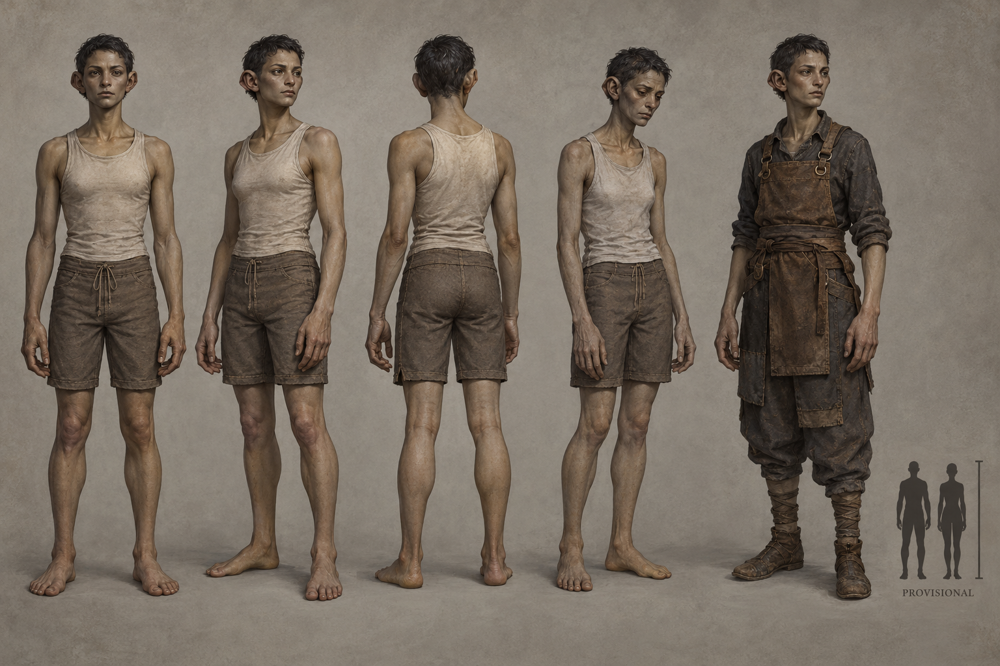

# Vaerin identity sheet — draft for owner review

Batch: item 28 (b), 2026-10-31. U1 / issue #537. This sheet replaces nothing and establishes no canon.

## Bible Open line

Source: [art-aesthetics-bible.md, Part III](../../../../../docs/art-aesthetics-bible.md).

> **Open:** the distinctive anatomy that takes them beyond conventional elves, including
> ears, facial proportions, build, palette, and any visible consequence of lost lifespan.
> Age loss does not by itself establish transparency, spectral bodies, or a fixed wrinkle pattern.

## Proposed answers

- Proposes: short broad folded auricles with a double outer rim, without conventional elf points. **Open item:** ears.
- Proposes: broad temple span, deep-set wide eyes, compressed lower face and a narrow chin. **Open item:** facial proportions.
- Proposes: narrow but substantial chest, long forearms and broad delicate hands, without a stock elven silhouette. **Open item:** build.
- Proposes: muted olive-grey living skin with warm umber undertones and charcoal hair. **Open item:** palette.
- Proposes: subtle loss of cheek and hand volume with less upright bearing; no fixed wrinkle code, transparency or paper skin. **Open item:** visible consequence of lost lifespan.

## Fixed facts honoured

Archivists; vellum and silence inform handling. Destroying an archived record removes a year of life. Living substantial bodies; lifespan loss has no ratified visual code.

Front, three-quarter and back healthy turnaround; fourth study is Waning-touched; fifth is a Dom worker with no class kit. The neutral worker clothing is a local dressing study, not a new company uniform or population ruling. The scale bar requests **1× Vael**, PROVISIONAL, with no runtime change. The only permitted image text is PROVISIONAL.

## Known weaknesses

- The double ear rim and compressed face distinguish this proposal, but long hands and eye/temple proportions still need a three-dimensional check.
- Lifespan expenditure reads partly as fatigue; it is not a quantitative ageing code. The 1.0 scale inset is approximate.

## Provenance and review

- Full-resolution PNG: 1536 × 1024; copied byte-for-byte from the generator, never downscaled or retouched.
- Generations used: 1 / 2; retained attempt 1.
- Full prompt, source path, timestamp and SHA-256: [provenance.json](provenance.json).
- Owner review and complete ruling list: [U1 contact sheet](../../../../../docs/qa/identity-sheets-2026-10-31/README.md).
