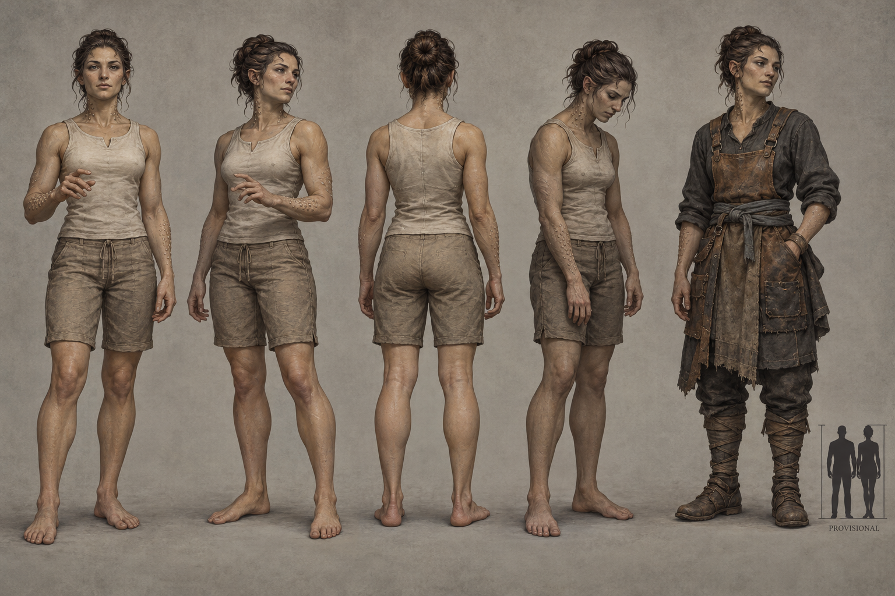

# Weftkin identity sheet — draft for owner review

Batch: item 28 (b), 2026-10-31. U1 / issue #537. This sheet replaces nothing and establishes no canon.

## Bible Open line

Source: [art-aesthetics-bible.md, Part III](../../../../../docs/art-aesthetics-bible.md).

> **Open:** healthy anatomy and material, how signal is sensed or expressed, and the
> literal versus figurative appearance of the severed shadow-puppet state. Healthy
> Weftkin are not defined as already hollow or voiceless.

## Proposed answers

- Proposes: solid cultivated living tissue, softly ridged forearms and a broad expressive biological face. **Open item:** healthy anatomy and material.
- Proposes: small interrupted runs of raised tactile pores along forearms and neck, echoed by one arrested hand gesture. **Open item:** how signal is sensed or expressed.
- Proposes: figurative: the same substantial person with slack unresponsive posture and interrupted gesture, without a literal shadow body. **Open item:** literal versus figurative severed shadow-puppet state.

## Fixed facts honoured

Biological person plus interrupted signal; Osse Vaal of Spindle-VI. Healthy people retain expression and voice; no holograms, electronic face or automatic fungal template. Severance is not a new Hollow body.

Front, three-quarter and back healthy turnaround; fourth study is Waning-touched; fifth is a Dom worker with no class kit. The neutral worker clothing is a local dressing study, not a new company uniform or population ruling. The scale bar requests **1× Vael**, PROVISIONAL, with no runtime change. The only permitted image text is PROVISIONAL.

## Known weaknesses

- The interrupted pore rows can read as skin nodules rather than sensed signal; their non-luminous biological interpretation remains a proposal.
- A still image cannot demonstrate missing voice or signal. The severed figure is a behavioral illustration with unchanged solid anatomy, not a new Hollow body.
- The 1.0 scale inset is approximate.

## Provenance and review

- Full-resolution PNG: 1536 × 1024; copied byte-for-byte from the generator, never downscaled or retouched.
- Generations used: 1 / 2; retained attempt 1.
- Full prompt, source path, timestamp and SHA-256: [provenance.json](provenance.json).
- Owner review and complete ruling list: [U1 contact sheet](../../../../../docs/qa/identity-sheets-2026-10-31/README.md).
