# U1 race and class-kit identity sheets — 2026-10-31

Open a thumbnail at full resolution, read its proposed decisions, and record **accept / <edit>** in the ruling list below. All 17 sheets are **draft-for-owner-review**; none is a replacement or an approved production asset.

Batch authorization: owner item 28 (b), `28: b go`, 2026-10-31. Issue #537; branch `codex/unit-art-u1`. Generator: **codex built-in image generation** only. **23 generations used / 34 maximum; no sheet exceeded two.**

## Read the sheets

Race sheets run left to right: healthy front, healthy three-quarter, healthy back, Waning-touched, Dom worker. The scale inset compares a Vael adult with the proposed race factor and is labelled PROVISIONAL. The insets are approximate painted comparisons, not measured model or runtime heights. Ghorr 1.15×; Orthos 1.1×; Vael, Vaerin, Weftkin and Kes'reth 1.0×; Kaan 0.9×. No 112 px runtime scale or actor art has changed.

Kit sheets show two healthy mortal race bases with equipment studies between them. Weapons and auxiliary tools come from the class catalog; each kit proposes one regalia assembly and one identifying mark/accessory. Ordinary undershirts, trousers and practical straps are supporting dress. Any incidental extra armor, jewelry or anatomy drift is called out in the sidecar and is not an additional design ruling.

The tool was asked for its largest native landscape output. Its interface exposes no numeric size control. Returned originals range from 1536 × 1024 to 1774 × 887 (also 1672 × 941); every delivered PNG is an unchanged full-resolution source copy. Thumbnails below use display width only. No raster contact sheet or extra art was generated.

## Sources and precedence

- [Handoff §§1–7](../../handoff-art-units-codex.md), [bible Part I and all of Part III](../../art-aesthetics-bible.md), [patron style guide](../../../design/god-aesthetic-style-guide.md), [class catalog](../../../globals/stats/class_catalog.gd), and [Chapter One prompts, including Iris Illepah](../../art-generation/chapter-one-prompts.md).
- Viewed finish references: `assets/generated/models/units/{vex,old-grumbrand,korrath-ninefold,ressa-quickfingers}/*--imagegen-source.png`. Their surface treatment, Earth palette and light guide this batch; Part III overrides their historical anatomy. Part II's UI chrome preamble was not used.
- Read-only vault evidence: `../../dramgid-vault/index.json`, the seven `peoples/<race>.md` files, `cities/dom.md`, and frozen `_source/dramgid-lore-dump.md:1386–1477`. The vault's older seed assignments, Mirror-Veil branch and fungal Weftkin template do not override Part III. No vault file changed.
- Dom is 58% Ghorr / 27% Vael / 6% Kaan / 4% Kes'reth / 5% mixed or other. Showing one Dom-dressed adult of each race is a dress study, not a new population distribution. Aprons and repaired work layers interpret the Iron Companies storm-port setting; no company uniform is ratified.
- Only handoff §4.2 faction colours are used, muted to Earth tones. River-Mother / Haeren, Husk-bearer / Vhorr and Locksmirk / Fickah use natural style-guide materials with **no assigned faction colour**. No Ofshütje depiction, Mirror-Veil body, two-armed Ghorr or Hollow body is included. Pazzah's erased notch remains unexplained.

## Generation ledger

| Sheet | Generations | Retained attempt | Native PNG |
|---|---:|---:|---|
| Vael | 2 | 2 | 1774 × 887 |
| Ghorr | 1 | 1 | 1774 × 887 |
| Kaan | 1 | 1 | 1536 × 1024 |
| Kes'reth | 1 | 1 | 1672 × 941 |
| Vaerin | 1 | 1 | 1536 × 1024 |
| Weftkin | 1 | 1 | 1536 × 1024 |
| Orthos | 2 | 2 | 1536 × 1024 |
| Mirrorblade | 1 | 1 | 1536 × 1024 |
| River-Mother | 1 | 1 | 1536 × 1024 |
| Ironbrand | 1 | 1 | 1536 × 1024 |
| Lensbearer | 2 | 2 | 1536 × 1024 |
| Husk-bearer | 1 | 1 | 1536 × 1024 |
| Flamebinder | 2 | 2 | 1536 × 1024 |
| Stormbearer | 1 | 1 | 1536 × 1024 |
| Oathclock | 2 | 2 | 1536 × 1024 |
| Locksmirk | 1 | 1 | 1536 × 1024 |
| Threadwalker | 2 | 2 | 1536 × 1024 |

**Total: 23 generations; 17 retained sheets; six superseded attempts.** No service failures or missing sheets. Superseded sources remain at their original generator paths and are recorded with their full prompts in the corresponding provenance JSON; they are not copied into this contact sheet. Remaining fidelity limitations after a second attempt are recorded below and in the sidecars. No further generation was performed.

## Verification

- All 17 retained results were visually inspected, including turnaround layout, state contrast, four-arm Ghorr anatomy, race pairings, prohibited depictions and text. Visual limitations are recorded per sheet; this is agent inspection, not owner approval.
- Asset/provenance/quote/link audit: **PASS**. All 17 source copies are byte-identical, all 17 SHA-256 values match, all 17 provenance files and sidecars are present, seven Open paragraphs are quoted exactly once, all 72 anatomy/kit proposal bullets and 78 ruling lines are present, all contact/sidecar links resolve, and all 23 recorded generation sources exist. Native sizes: fourteen 1536 × 1024, two 1774 × 887, one 1672 × 941. PNG total: 45,869,108 bytes.
- Required `bash scripts/check_generated_data.sh`: **PASS, exit 0, directly in this worktree**, Godot **4.7.1.stable.official.a13da4feb**. All four stages reported no drift; 598 sprites were verified. The initial fresh-worktree runs failed before `GLOOT-GEN` because the imported class cache was absent (`GlobalState`, `DialogueResource` and other types unresolved). Two imports, matching the CI bootstrap, ran in an isolated archive of `7ec4e9a358442c7a3077a16221d71365c398c347`; both exited 0. The snapshot's 19,527 tracked files matched the worktree except the intentional owner-list note. Only its ignored `.godot/` cache was copied back before the successful worktree guard. No source imports, runtime art or code were rewritten.
- Import logs include plugin/editor cleanup, socket and settings-save messages; the first import also reported bootstrap class errors. The successful guard still logged ObjectDB leak warnings and four non-fatal resource-use errors at shutdown (one stage reported 13 resources, three reported 15). It did not crash. Exit 0 and no drift do not establish leak-free engine teardown or owner acceptance of the images.
- `git diff --check` and protected-path audit: **PASS**. Changes are confined to the 51 race/kit deliverables, this README, and the item-28 owner-list update. No protected runtime-art, manifest, data, script, scene, Pandora or addon source changed. No game scene is wired to these review PNGs, so a gameplay screenshot or full regression sweep would not exercise a changed runtime behavior.

Successful worktree guard output:

```text
GLOOT-GEN: no drift.
CANON-SEED: no drift.
LOCATIONS-GEN: no drift.
ISO-SPRITE-GEN: no drift. 598 sprites verified.
```

## Race contact sheet

### Vael

[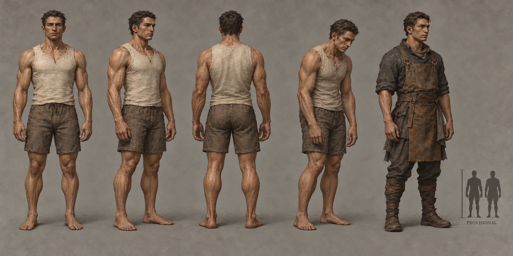](../../../assets/generated/models/races/vael/identity-sheet.png)

[Proposals, bible quote and weaknesses](../../../assets/generated/models/races/vael/identity-sheet.md) · [Full prompt and provenance](../../../assets/generated/models/races/vael/provenance.json)

- Proposes: **silhouette** — upright, gently squared shoulders and a controlled vertical stance.
- Proposes: **bodily substrate** — living matte tissue held in broad fibrous tension planes, a draft surface hypothesis rather than fixed canon.
- Proposes: **facial structure** — broad planar brow and cheek planes, shallow temples, compact rounded ears.
- Proposes: **proportions** — approximately seven-and-a-half heads with moderate limbs and baseline breadth.
- Proposes: **surface palette** — warm clay-brown with cool grey-olive shadows; no colour assigned to B-flat.
- Proposes: **loss of rigidity on a living person** — softened face planes, bowed forearms and slack shoulders while the person remains solid and alive.

Known weaknesses: Tissue ridges are visible after the second attempt, but the Waning pose still reads partly as fatigue; the substrate is a visual hypothesis, not proof of a biological mechanism. The scale inset's tops are still slightly uneven despite the requested 1.0 ratio. Treat the written factor as authoritative for this draft; no runtime height is changed. The two-dimensional turnaround does not prove joint construction or physical consistency.

### Ghorr

[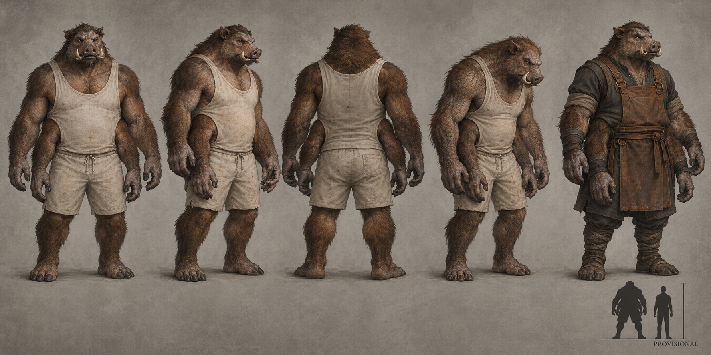](../../../assets/generated/models/races/ghorr/identity-sheet.png)

[Proposals, bible quote and weaknesses](../../../assets/generated/models/races/ghorr/identity-sheet.md) · [Full prompt and provenance](../../../assets/generated/models/races/ghorr/provenance.json)

- Proposes: **placement and relative size of the two arm pairs** — upper shoulders wide at collar level, a second pair below the ribs angled slightly forward; lower arms about four-fifths the upper pair's length.
- Proposes: **hand anatomy** — four thick fingers and one opposable thumb on each of four broad padded hands.
- Proposes: **fur coverage** — coarse short fur on back, shoulders and outer limbs, with sparse chest and exposed palms and muzzle.
- Proposes: **snout and tusks** — broad flattened warthog-like muzzle with one modest upward-curving lower tusk on each side.
- Proposes: **leg posture** — broad plantigrade feet and bent load-bearing knees under a barrel torso.
- Proposes: **relative scale** — 1.15 times the Vael adult, PROVISIONAL.
- Proposes: **surface palette** — peat-brown fur, grey-brown hide and worn-ivory tusks.

Known weaknesses: The four arms are visible, but shoulder attachment and lower-hand size vary slightly between views; the claimed five-digit hand anatomy needs a modeling study. The scale inset approximates 1.15 rather than measuring it precisely. Heavy/brittle decline is clearest at the shoulder; other stress surfaces remain understated.

### Kaan

[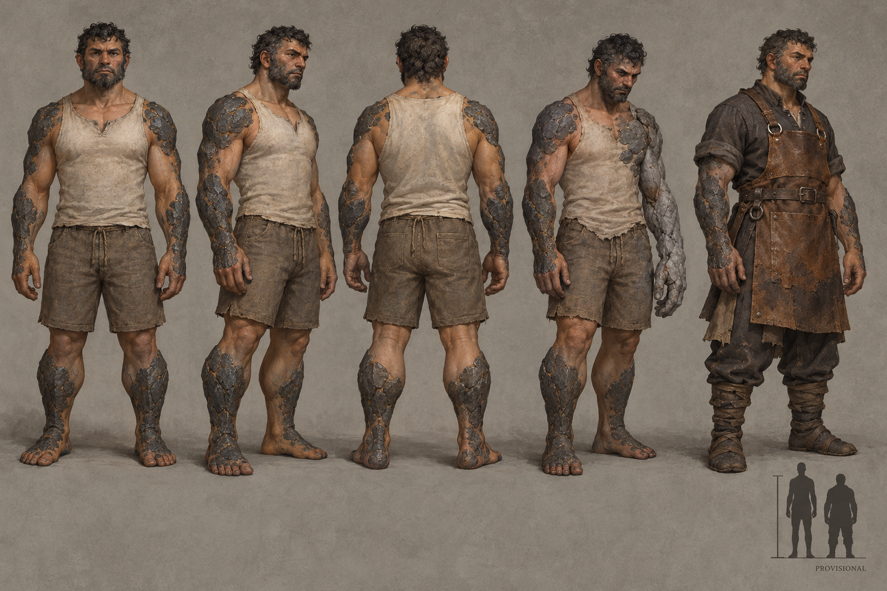](../../../assets/generated/models/races/kaan/identity-sheet.png)

[Proposals, bible quote and weaknesses](../../../assets/generated/models/races/kaan/identity-sheet.md) · [Full prompt and provenance](../../../assets/generated/models/races/kaan/provenance.json)

- Proposes: **body proportions** — compact broad torso, short sturdy lower legs and long working forearms.
- Proposes: **mineral coverage and type** — irregular dark basalt-like plates over shoulders, forearms and shins, leaving most joints mobile.
- Proposes: **exposed flesh** — warm umber living tissue at face, palms and flexion folds.
- Proposes: **hair/beard structure** — coarse short dark hair and beard with sparse grey grit; mineral threading remains weakly resolved.
- Proposes: **joint behavior** — supple skin folds between mineral plates, with ordinary bending in healthy wrists and knees.
- Proposes: **progression from healthy body to inert stone** — left hand and forearm close into continuous stone first, with mineral spreading through joints toward a fully settled body.

Known weaknesses: Mineral granules in hair and beard are not clearly resolved; the visible proposal remains coarse short hair/beard with sparse grey grit. On the Waning figure mineral and shirt edges overlap at the chest. The inset is approximate; the requested height factor is 0.9. The progression ends at a partly settled living stage rather than a fully inert endpoint.

### Kes'reth

[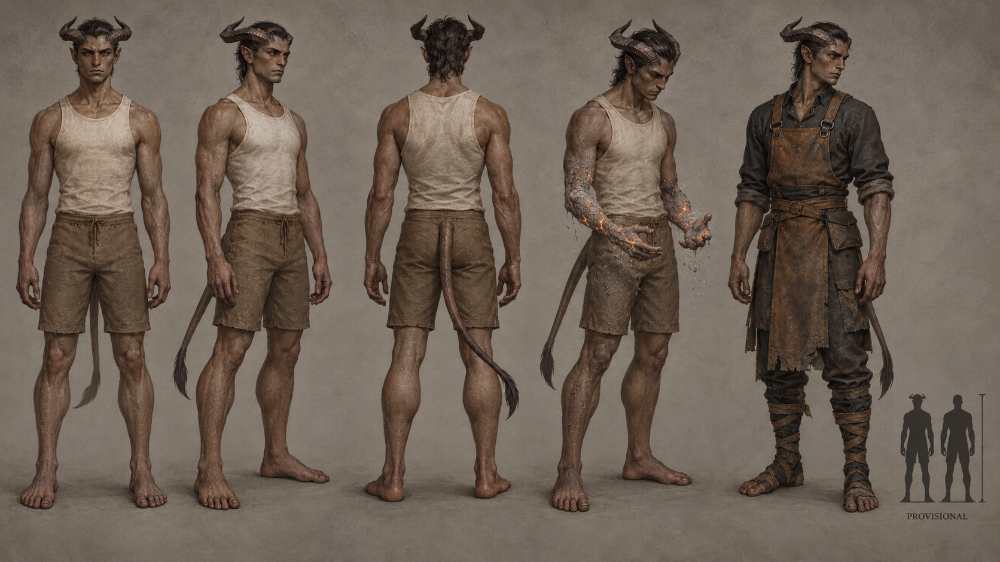](../../../assets/generated/models/races/kes-reth/identity-sheet.png)

[Proposals, bible quote and weaknesses](../../../assets/generated/models/races/kes-reth/identity-sheet.md) · [Full prompt and provenance](../../../assets/generated/models/races/kes-reth/provenance.json)

- Proposes: **horn arrangement** — two ridged horns growing above the temples and sweeping backward then slightly upward.
- Proposes: **face** — high cheek planes, broad low nose and deep-set eyes with restrained heat at the inner corners.
- Proposes: **build** — lean durable torso and sinewy limbs with controlled upright bearing.
- Proposes: **skin and ash palette** — warm umber-grey skin, charcoal horns, cool pale ash and tiny ember-orange fissures.
- Proposes: **tail/feet anatomy** — one lean tapering tail with a dark terminal tassel and plantigrade five-toed feet.
- Proposes: **healthy-to-combusting transition** — cool ash gathers along hands and forearms as tiny ember seams consume surface tissue slowly, without whole-body flames.

Known weaknesses: The generated tail ends in a dark tassel, and horn spread varies slightly across views; those tail/horn details are draft anatomy only. Ash fractures risk reading as lava-like stone at thumbnail size; the scene depicts local slow combustion, not a healthy burning body. Inset height is approximate and counts horn tips; the proposed body-height factor is 1.0.

### Vaerin

[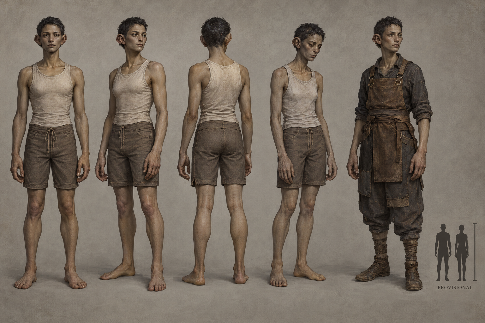](../../../assets/generated/models/races/vaerin/identity-sheet.png)

[Proposals, bible quote and weaknesses](../../../assets/generated/models/races/vaerin/identity-sheet.md) · [Full prompt and provenance](../../../assets/generated/models/races/vaerin/provenance.json)

- Proposes: **ears** — short broad folded auricles with a double outer rim, without conventional elf points.
- Proposes: **facial proportions** — broad temple span, deep-set wide eyes, compressed lower face and a narrow chin.
- Proposes: **build** — narrow but substantial chest, long forearms and broad delicate hands, without a stock elven silhouette.
- Proposes: **palette** — muted olive-grey living skin with warm umber undertones and charcoal hair.
- Proposes: **visible consequence of lost lifespan** — subtle loss of cheek and hand volume with less upright bearing; no fixed wrinkle code, transparency or paper skin.

Known weaknesses: The double ear rim and compressed face distinguish this proposal, but long hands and eye/temple proportions still need a three-dimensional check. Lifespan expenditure reads partly as fatigue; it is not a quantitative ageing code. The 1.0 scale inset is approximate.

### Weftkin

[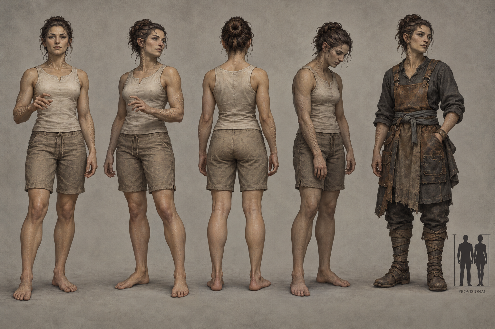](../../../assets/generated/models/races/weftkin/identity-sheet.png)

[Proposals, bible quote and weaknesses](../../../assets/generated/models/races/weftkin/identity-sheet.md) · [Full prompt and provenance](../../../assets/generated/models/races/weftkin/provenance.json)

- Proposes: **healthy anatomy and material** — solid cultivated living tissue, softly ridged forearms and a broad expressive biological face.
- Proposes: **how signal is sensed or expressed** — small interrupted runs of raised tactile pores along forearms and neck, echoed by one arrested hand gesture.
- Proposes: **literal versus figurative severed shadow-puppet state** — figurative: the same substantial person with slack unresponsive posture and interrupted gesture, without a literal shadow body.

Known weaknesses: The interrupted pore rows can read as skin nodules rather than sensed signal; their non-luminous biological interpretation remains a proposal. A still image cannot demonstrate missing voice or signal. The severed figure is a behavioral illustration with unchanged solid anatomy, not a new Hollow body. The 1.0 scale inset is approximate.

### Orthos

[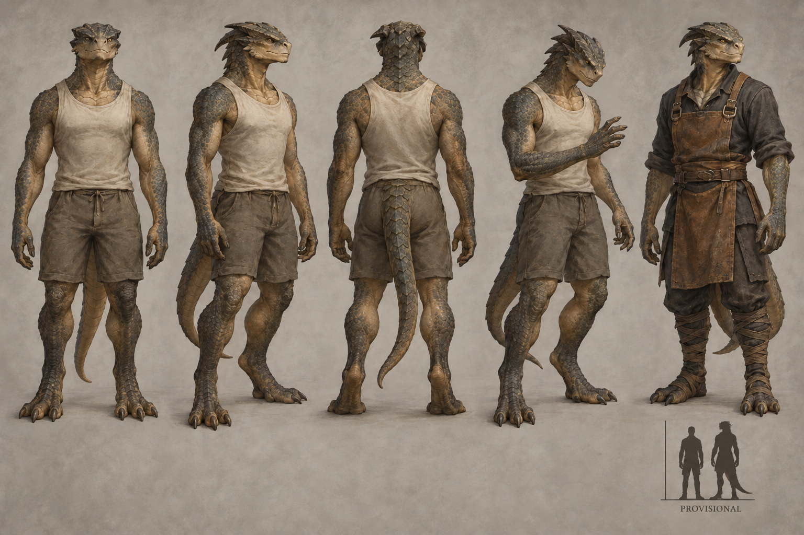](../../../assets/generated/models/races/orthos/identity-sheet.png)

[Proposals, bible quote and weaknesses](../../../assets/generated/models/races/orthos/identity-sheet.md) · [Full prompt and provenance](../../../assets/generated/models/races/orthos/provenance.json)

- Proposes: **head and muzzle** — broad wedge head with a short blunt muzzle, offset stepped brow plates and lateral nostrils.
- Proposes: **scales or other surface** — small interlocking slate-olive scales with broad throat plates.
- Proposes: **horns** — low swept-back horn ridges within a layered head crest.
- Proposes: **tail** — one muscular tapering balancing tail, held low.
- Proposes: **limb proportions** — long forearms, robust thighs, low raised heels and broad feet with four visible foretoes.
- Proposes: **how strongly draconic the body reads** — clearly draconic head, hide, hands, feet and tail, while upright and wingless.

Known weaknesses: The generator produced broader horn/crest clusters and four visible foretoes rather than the prompt's two simple horn ridges and three-toed feet; the visible crest and four-toed proposal is what the owner is reviewing. Temporal drift can read as an arrested inspection gesture; a static sheet cannot prove a six-minute loop. The second attempt enlarged the scale inset toward the requested 1.1 factor, but it remains an approximate illustration; do not derive production height from its pixels.

## Class-kit contact sheet

### Mirrorblade

[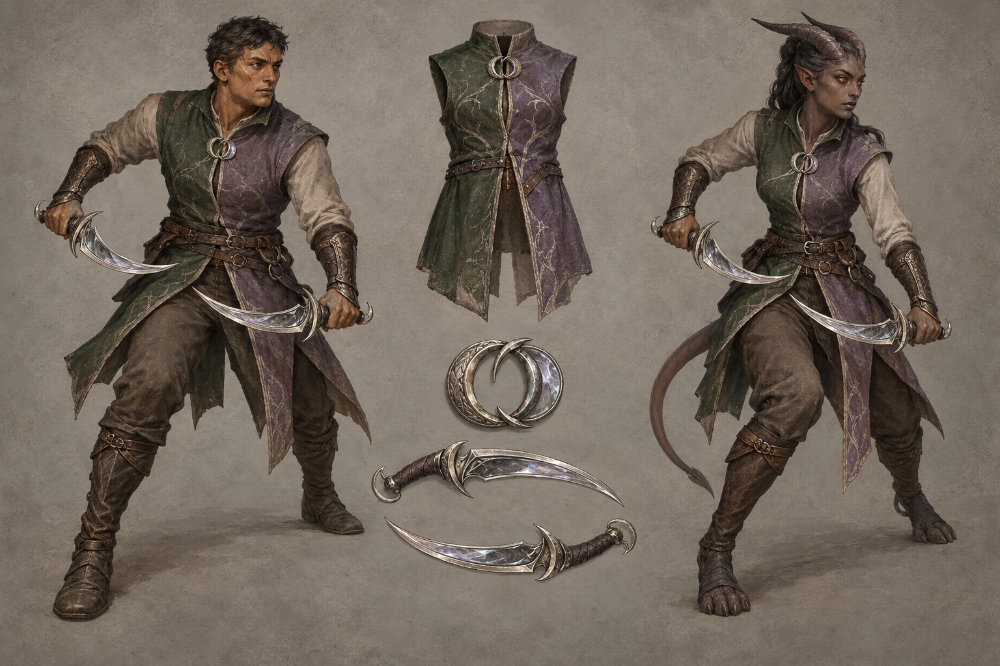](../../../assets/generated/models/kits/mirrorblade/identity-sheet.png)

Race bases, left / right: **vael / kes-reth**. [Proposals and weaknesses](../../../assets/generated/models/kits/mirrorblade/identity-sheet.md) · [Full prompt and provenance](../../../assets/generated/models/kits/mirrorblade/provenance.json)

- Proposes: **weapon presentation** — equal balanced crescent daggers in cold mirror-ground steel with dark wrapped grips.
- Proposes: **regalia piece** — a bilateral short forest-green and dusty-lilac duelist tabard with one interrupted silver seam.
- Proposes: **mark or accessory** — a silver paired-crescent ring clasp with offset reflective surfaces.

Allowed colour treatment: Forest Green / Lilac, muted to moss green and dusty grey-lilac.

Known weaknesses: Daggers and bracers are more ornate than the plain working proposal; the tabard also carries more decorative surface detail than the brief requested. Delayed reflection and the one broken seam cannot be read reliably at thumbnail size. The kit sheet is not authority to change Kes'reth anatomy or feet.

### River-Mother

[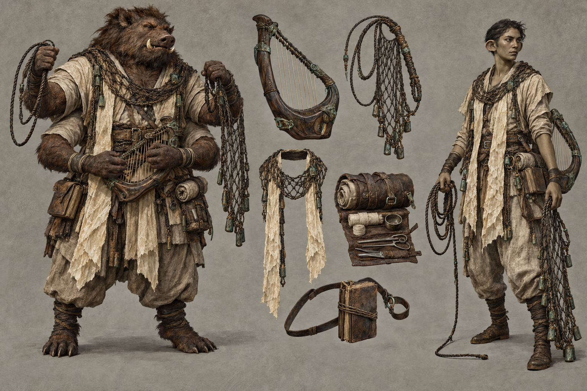](../../../assets/generated/models/kits/river-mother/identity-sheet.png)

Race bases, left / right: **ghorr / vaerin**. [Proposals and weaknesses](../../../assets/generated/models/kits/river-mother/identity-sheet.md) · [Full prompt and provenance](../../../assets/generated/models/kits/river-mother/provenance.json)

- Proposes: **weapon and tool presentation** — a tarred net-and-whip, swollen-wood water harp and compact hospice-tool roll.
- Proposes: **regalia piece** — a narrow salt-stiffened net stole with long wet-vellum registers.
- Proposes: **mark or accessory** — a closed cockled Name-Ledger on a plain waist sling, without lettering.
- Proposes: **Ghorr weapon arm pair** — upper pair handles net and whip; lower pair supports the water harp.

Allowed colour treatment: None in canon; undyed vellum, tarred cordage, weathered wood, worn leather and tiny dull verdigris fittings only.

Known weaknesses: The wet-vellum stole risks reading as torn fabric; wetness and reused paper need a material study. Harp strings, net strands and the lower Ghorr hand contacts overlap in places; four arms remain visible, but attachment clearance is not a rigging proof.

### Ironbrand

[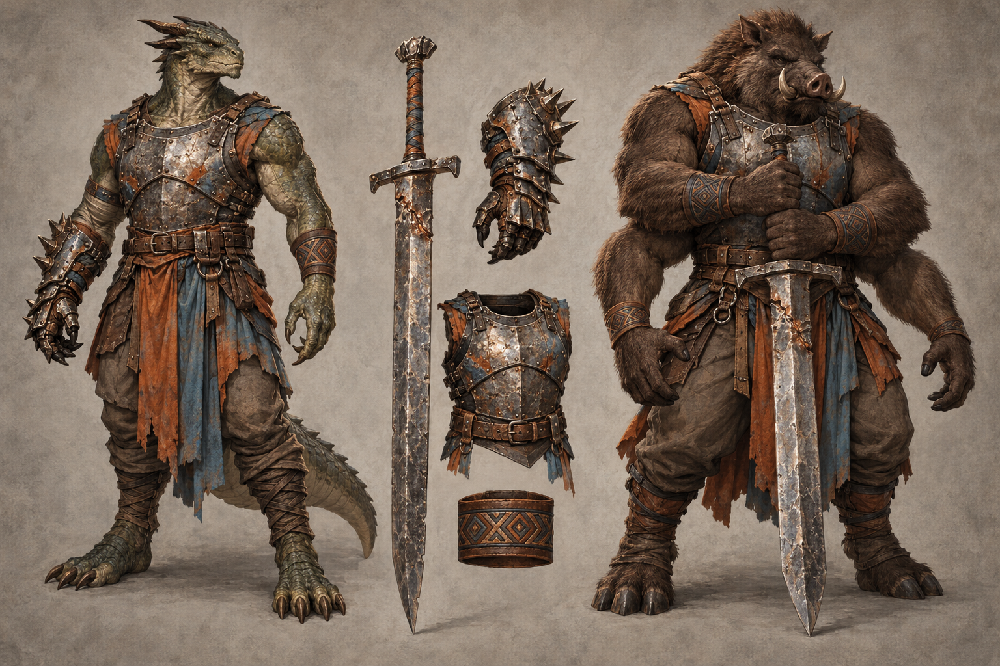](../../../assets/generated/models/kits/ironbrand/identity-sheet.png)

Race bases, left / right: **orthos / ghorr**. [Proposals and weaknesses](../../../assets/generated/models/kits/ironbrand/identity-sheet.md) · [Full prompt and provenance](../../../assets/generated/models/kits/ironbrand/provenance.json)

- Proposes: **weapon presentation** — greatsword with a visible rejoined steel seam, plus spiked gauntlet as the alternative loadout.
- Proposes: **regalia piece** — a load-bearing riveted breastplate with repaired welds and small rust-orange and dusty-blue cloth insets.
- Proposes: **mark or accessory** — a counted geometric brand register on a leather forearm band.
- Proposes: **Ghorr weapon arm pair** — upper pair grips the greatsword; lower pair stays empty and visible.

Allowed colour treatment: Sunset Orange / Robin's Egg Blue, muted rust-orange and dusty blue-grey.

Known weaknesses: The ritual-brand register is readable as ornament, but counting and symbolic meaning are deliberately unspecified. The wrist bands repeat on multiple Ghorr arms, and the breastplate includes attached cloth panels; these remain one mark family and one regalia assembly, not new mechanics.

### Lensbearer

[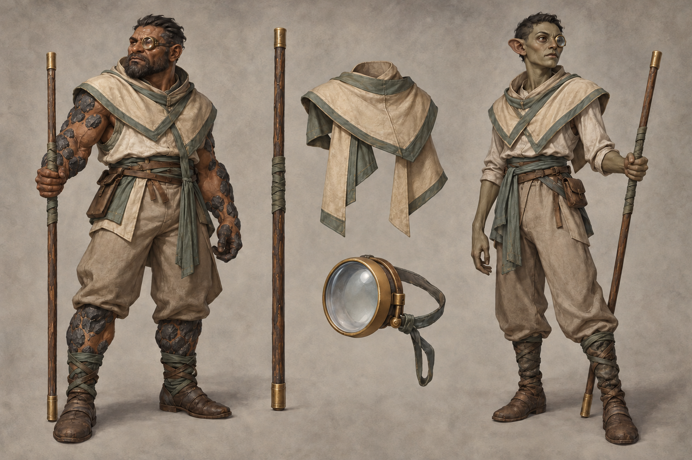](../../../assets/generated/models/kits/lensbearer/identity-sheet.png)

Race bases, left / right: **kaan / vaerin**. [Proposals and weaknesses](../../../assets/generated/models/kits/lensbearer/identity-sheet.md) · [Full prompt and provenance](../../../assets/generated/models/kits/lensbearer/provenance.json)

- Proposes: **weapon presentation** — a plain hardwood quarterstaff with small dull brass ferrules.
- Proposes: **regalia piece** — a fitted parchment-beige shoulder mantle edged in muted seafoam cloth.
- Proposes: **mark or accessory** — a precision-ground monocle with one small functional dull-brass hinge.

Allowed colour treatment: Seafoam Green / Parchment Beige, desaturated grey-green and aged beige.

Known weaknesses: The second attempt removed inscription-like marks from the monocle. Brass is brighter than the dull-material brief and may need less polish. The Vaerin head proportions and ears vary from the race sheet; the race identity sheet remains the base proposal. Monocle fit at the eye is not a tested attachment.

### Husk-bearer

[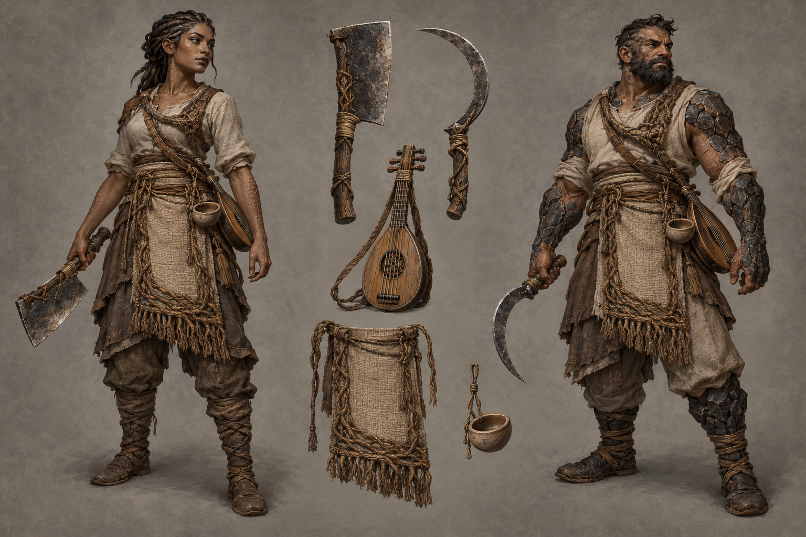](../../../assets/generated/models/kits/husk-bearer/identity-sheet.png)

Race bases, left / right: **weftkin / kaan**. [Proposals and weaknesses](../../../assets/generated/models/kits/husk-bearer/identity-sheet.md) · [Full prompt and provenance](../../../assets/generated/models/kits/husk-bearer/provenance.json)

- Proposes: **weapon and tool presentation** — a rooted-wood-handled cleaver and simple sickle alternatives, with a gut-strung lute.
- Proposes: **regalia piece** — one carefully woven plant-fibre service apron with pruned root-bound edging.
- Proposes: **mark or accessory** — a matte ceramic empty-bowl token carried at the apron tie.

Allowed colour treatment: None in canon; root-bound wood, undyed woven fibre, matte unglazed clay and worked iron only.

Known weaknesses: The empty-bowl token reads as a small usable bowl; the owner should rule on its size rather than infer a new ritual. Root edging can read as ordinary cord. The lute's gut-string material cannot be established from a still image.

### Flamebinder

[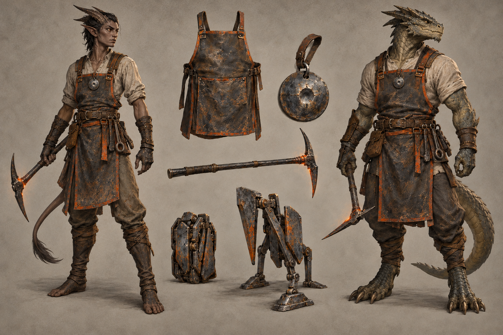](../../../assets/generated/models/kits/flamebinder/identity-sheet.png)

Race bases, left / right: **kes-reth / orthos**. [Proposals and weaknesses](../../../assets/generated/models/kits/flamebinder/identity-sheet.md) · [Full prompt and provenance](../../../assets/generated/models/kits/flamebinder/provenance.json)

- Proposes: **weapon and construct presentation** — a soot-blackened war pick and compact folding kinetic-sculpture emplacement with simple hinged plates.
- Proposes: **regalia piece** — a heavy forge apron with a small copper-orange cloth edge.
- Proposes: **mark or accessory** — a heat-tempered steel token retaining an imperfect test indentation.

Allowed colour treatment: Copper Orange / Steel Gray, muted oxidized orange and soot-grey.

Known weaknesses: The correction shows the token on both wearers and makes Kes'reth horns sweep back, but their length still differs from the race sheet. The deployed construct's four legs can suggest locomotion; this drawing proposes an immobile emplacement silhouette only, not walking, attacks or new behavior. Pick-head heat and copper-orange apron edges are stronger than some neighboring kits; saturation and active heat remain review points.

### Stormbearer

[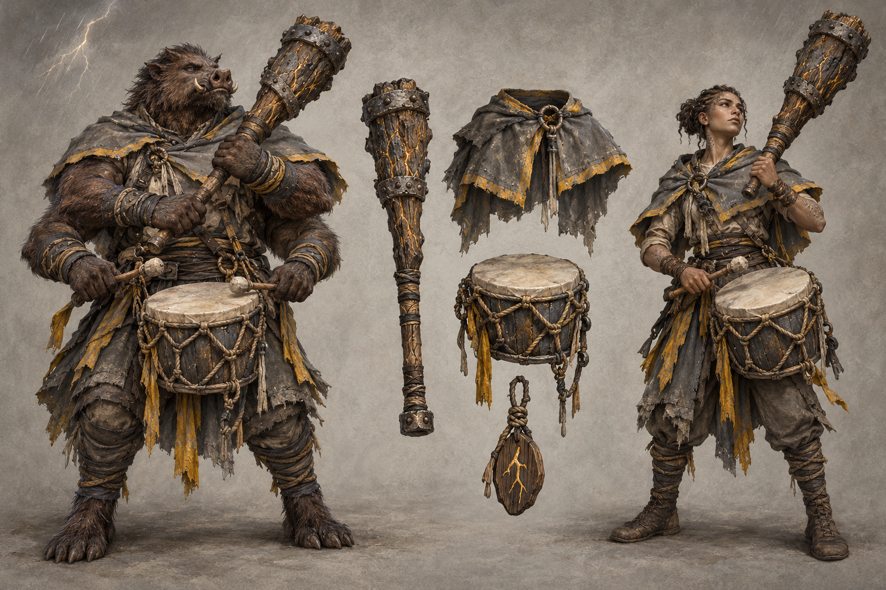](../../../assets/generated/models/kits/stormbearer/identity-sheet.png)

Race bases, left / right: **ghorr / weftkin**. [Proposals and weaknesses](../../../assets/generated/models/kits/stormbearer/identity-sheet.md) · [Full prompt and provenance](../../../assets/generated/models/kits/stormbearer/provenance.json)

- Proposes: **weapon and tool presentation** — a lightning-scarred timber greatclub with pitted meteoric-iron bands and a canvas cloud-drum.
- Proposes: **regalia piece** — one short storm-battered canvas shoulder cape with a sparse ochre edge.
- Proposes: **mark or accessory** — a small timber charm carved with a single selected lightning fork.
- Proposes: **Ghorr weapon arm pair** — upper pair grips the greatclub; lower pair plays the cloud-drum with mallets.

Allowed colour treatment: Storm Gray / Lightning Yellow, muted storm-grey and sparse ochre-yellow.

Known weaknesses: The club fissures read as a stronger persistent glow than the intended sparse weather effect; this is not a new weapon property. The lower Ghorr pair plays the cloud-drum with mallets rather than merely steadying it. All four arms are visible; the arm assignment is a proposal, not a combat rule.

### Oathclock

[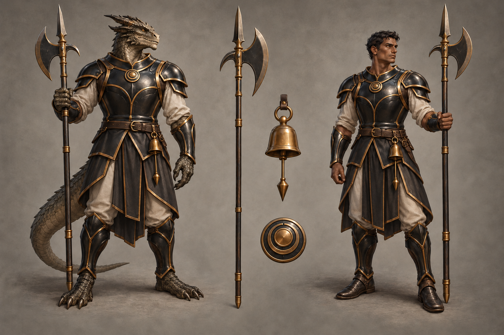](../../../assets/generated/models/kits/oathclock/identity-sheet.png)

Race bases, left / right: **orthos / vael**. [Proposals and weaknesses](../../../assets/generated/models/kits/oathclock/identity-sheet.md) · [Full prompt and provenance](../../../assets/generated/models/kits/oathclock/provenance.json)

- Proposes: **weapon and tool presentation** — an immaculate straight halberd and small visible pendulum bell on a plain suspension.
- Proposes: **regalia piece** — one perfectly maintained symmetric ash-black lacquered cuirass with bronze margins.
- Proposes: **mark or accessory** — a small bronze concentric-ring badge without numbered graduations.

Allowed colour treatment: Ash Black / Bronze, warm charcoal-black lacquer and restrained bronze.

Known weaknesses: The second attempt polished the kit, but the badge close-up retains a tiny dark junction between ring highlights. It has no assigned lore meaning and does not explain or reconstruct the erased notch. The generator extends the cuirass into matching arm and leg protection. Treat that extra coverage as incidental draft dressing; the proposed regalia piece is the cuirass. The polished surfaces approach a cleaner rendering finish than the other kits; the owner should judge whether the patron-specific refinement remains inside the painted house style.

### Locksmirk

[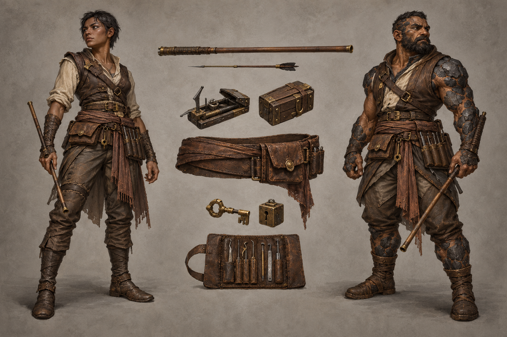](../../../assets/generated/models/kits/locksmirk/identity-sheet.png)

Race bases, left / right: **vael / kaan**. [Proposals and weaknesses](../../../assets/generated/models/kits/locksmirk/identity-sheet.md) · [Full prompt and provenance](../../../assets/generated/models/kits/locksmirk/provenance.json)

- Proposes: **weapon and tool presentation** — a narrow plain wood blowgun, a pocket-sized spring trap and small worn lockpicks.
- Proposes: **regalia piece** — one practical worn-leather tool sash with discreet false-front pocket.
- Proposes: **mark or accessory** — a mismatched key-and-lock token worn at the sash.

Allowed colour treatment: None in canon; worn leather, dull miniature brass, worked steel and plain wood only.

Known weaknesses: The depicted pocket mechanism is a visual prop, not a construction diagram or a newly specified trap effect. False-front pocket and key mismatch are not fully demonstrable in one view. No faction colour has been assigned.

### Threadwalker

[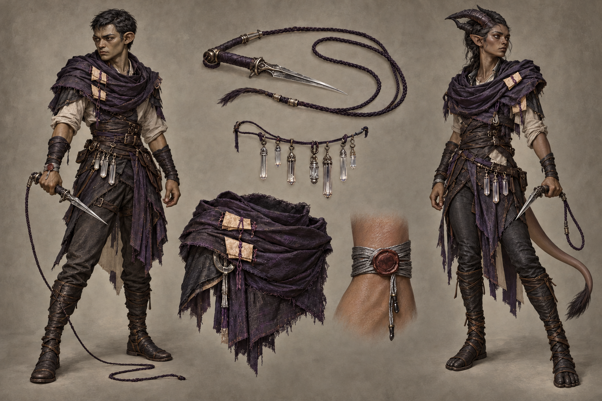](../../../assets/generated/models/kits/threadwalker/identity-sheet.png)

Race bases, left / right: **vaerin / kes-reth**. [Proposals and weaknesses](../../../assets/generated/models/kits/threadwalker/identity-sheet.md) · [Full prompt and provenance](../../../assets/generated/models/kits/threadwalker/provenance.json)

- Proposes: **weapon and tool presentation** — a dagger attached to a taut fine-cord whip with a small set of clear glass chimes.
- Proposes: **regalia piece** — one dry matte violet-black notarial shoulder wrap with sewn-closed parchment slips.
- Proposes: **mark or accessory** — a silver-thread wrist binding secured by a plain wax seal.

Allowed colour treatment: Violet-Black / Thread-Silver, near-charcoal muted violet and restrained silver.

Known weaknesses: The second attempt corrected the left Vaerin's pointed ears and the right Kes'reth's hoof-like footwear, but facial proportions still drift from the race sheet. The wrist accessory is more heavily wrapped than a single fine thread, and the wax-seal attachment is clearest in the close-up rather than on both bodies. Whip tension relaxes in the object study; the sheet does not define an attack animation or a new resource display.

## Race coverage across kits

| Race | Appearances | Kit sheets |
|---|---:|---|
| Vael | 3 | Mirrorblade, Oathclock, Locksmirk |
| Ghorr | 3 | River-Mother, Ironbrand, Stormbearer |
| Kaan | 3 | Lensbearer, Husk-bearer, Locksmirk |
| Kes'reth | 3 | Mirrorblade, Flamebinder, Threadwalker |
| Vaerin | 3 | River-Mother, Lensbearer, Threadwalker |
| Weftkin | 2 | Husk-bearer, Stormbearer |
| Orthos | 3 | Ironbrand, Flamebinder, Oathclock |

## Owner rulings requested

The seven bible Open paragraphs appear once each in their race sidecars, covering **39 anatomy items**. The list also includes six additional height decisions (Ghorr's height is already a bible Open item) and **33 kit presentation/attachment decisions**: **78 lines total**. Kit decisions answer the handoff contract; the bible has no kit-specific Open lines. Every line remains unanswered. Acceptance of a sheet does not authorize runtime integration, settle unrelated lore, approve new faction colours, or authorize another generation batch.

- Vael: silhouette — proposed upright, gently squared shoulders and a controlled vertical stance; answer: accept / `<edit>`
- Vael: bodily substrate — proposed living matte tissue held in broad fibrous tension planes, a draft surface hypothesis rather than fixed canon; answer: accept / `<edit>`
- Vael: facial structure — proposed broad planar brow and cheek planes, shallow temples, compact rounded ears; answer: accept / `<edit>`
- Vael: proportions — proposed approximately seven-and-a-half heads with moderate limbs and baseline breadth; answer: accept / `<edit>`
- Vael: surface palette — proposed warm clay-brown with cool grey-olive shadows; no colour assigned to B-flat; answer: accept / `<edit>`
- Vael: loss of rigidity on a living person — proposed softened face planes, bowed forearms and slack shoulders while the person remains solid and alive; answer: accept / `<edit>`
- Vael: relative height — proposed 1× Vael adult, PROVISIONAL; inset pixels are illustrative; answer: accept / `<edit>`
- Ghorr: placement and relative size of the two arm pairs — proposed upper shoulders wide at collar level, a second pair below the ribs angled slightly forward; lower arms about four-fifths the upper pair's length; answer: accept / `<edit>`
- Ghorr: hand anatomy — proposed four thick fingers and one opposable thumb on each of four broad padded hands; answer: accept / `<edit>`
- Ghorr: fur coverage — proposed coarse short fur on back, shoulders and outer limbs, with sparse chest and exposed palms and muzzle; answer: accept / `<edit>`
- Ghorr: snout and tusks — proposed broad flattened warthog-like muzzle with one modest upward-curving lower tusk on each side; answer: accept / `<edit>`
- Ghorr: leg posture — proposed broad plantigrade feet and bent load-bearing knees under a barrel torso; answer: accept / `<edit>`
- Ghorr: relative scale — proposed 1.15 times the Vael adult, PROVISIONAL; answer: accept / `<edit>`
- Ghorr: surface palette — proposed peat-brown fur, grey-brown hide and worn-ivory tusks; answer: accept / `<edit>`
- Kaan: body proportions — proposed compact broad torso, short sturdy lower legs and long working forearms; answer: accept / `<edit>`
- Kaan: mineral coverage and type — proposed irregular dark basalt-like plates over shoulders, forearms and shins, leaving most joints mobile; answer: accept / `<edit>`
- Kaan: exposed flesh — proposed warm umber living tissue at face, palms and flexion folds; answer: accept / `<edit>`
- Kaan: hair/beard structure — proposed coarse short dark hair and beard with sparse grey grit; mineral threading remains weakly resolved; answer: accept / `<edit>`
- Kaan: joint behavior — proposed supple skin folds between mineral plates, with ordinary bending in healthy wrists and knees; answer: accept / `<edit>`
- Kaan: progression from healthy body to inert stone — proposed left hand and forearm close into continuous stone first, with mineral spreading through joints toward a fully settled body; answer: accept / `<edit>`
- Kaan: relative height — proposed 0.9× Vael adult, PROVISIONAL; inset pixels are illustrative; answer: accept / `<edit>`
- Kes'reth: horn arrangement — proposed two ridged horns growing above the temples and sweeping backward then slightly upward; answer: accept / `<edit>`
- Kes'reth: face — proposed high cheek planes, broad low nose and deep-set eyes with restrained heat at the inner corners; answer: accept / `<edit>`
- Kes'reth: build — proposed lean durable torso and sinewy limbs with controlled upright bearing; answer: accept / `<edit>`
- Kes'reth: skin and ash palette — proposed warm umber-grey skin, charcoal horns, cool pale ash and tiny ember-orange fissures; answer: accept / `<edit>`
- Kes'reth: tail/feet anatomy — proposed one lean tapering tail with a dark terminal tassel and plantigrade five-toed feet; answer: accept / `<edit>`
- Kes'reth: healthy-to-combusting transition — proposed cool ash gathers along hands and forearms as tiny ember seams consume surface tissue slowly, without whole-body flames; answer: accept / `<edit>`
- Kes'reth: relative height — proposed 1× Vael adult, PROVISIONAL; inset pixels are illustrative; answer: accept / `<edit>`
- Vaerin: ears — proposed short broad folded auricles with a double outer rim, without conventional elf points; answer: accept / `<edit>`
- Vaerin: facial proportions — proposed broad temple span, deep-set wide eyes, compressed lower face and a narrow chin; answer: accept / `<edit>`
- Vaerin: build — proposed narrow but substantial chest, long forearms and broad delicate hands, without a stock elven silhouette; answer: accept / `<edit>`
- Vaerin: palette — proposed muted olive-grey living skin with warm umber undertones and charcoal hair; answer: accept / `<edit>`
- Vaerin: visible consequence of lost lifespan — proposed subtle loss of cheek and hand volume with less upright bearing; no fixed wrinkle code, transparency or paper skin; answer: accept / `<edit>`
- Vaerin: relative height — proposed 1× Vael adult, PROVISIONAL; inset pixels are illustrative; answer: accept / `<edit>`
- Weftkin: healthy anatomy and material — proposed solid cultivated living tissue, softly ridged forearms and a broad expressive biological face; answer: accept / `<edit>`
- Weftkin: how signal is sensed or expressed — proposed small interrupted runs of raised tactile pores along forearms and neck, echoed by one arrested hand gesture; answer: accept / `<edit>`
- Weftkin: literal versus figurative severed shadow-puppet state — proposed figurative: the same substantial person with slack unresponsive posture and interrupted gesture, without a literal shadow body; answer: accept / `<edit>`
- Weftkin: relative height — proposed 1× Vael adult, PROVISIONAL; inset pixels are illustrative; answer: accept / `<edit>`
- Orthos: head and muzzle — proposed broad wedge head with a short blunt muzzle, offset stepped brow plates and lateral nostrils; answer: accept / `<edit>`
- Orthos: scales or other surface — proposed small interlocking slate-olive scales with broad throat plates; answer: accept / `<edit>`
- Orthos: horns — proposed low swept-back horn ridges within a layered head crest; answer: accept / `<edit>`
- Orthos: tail — proposed one muscular tapering balancing tail, held low; answer: accept / `<edit>`
- Orthos: limb proportions — proposed long forearms, robust thighs, low raised heels and broad feet with four visible foretoes; answer: accept / `<edit>`
- Orthos: how strongly draconic the body reads — proposed clearly draconic head, hide, hands, feet and tail, while upright and wingless; answer: accept / `<edit>`
- Orthos: relative height — proposed 1.1× Vael adult, PROVISIONAL; inset pixels are illustrative; answer: accept / `<edit>`
- Mirrorblade: weapon presentation — proposed equal balanced crescent daggers in cold mirror-ground steel with dark wrapped grips; answer: accept / `<edit>`
- Mirrorblade: regalia piece — proposed a bilateral short forest-green and dusty-lilac duelist tabard with one interrupted silver seam; answer: accept / `<edit>`
- Mirrorblade: mark or accessory — proposed a silver paired-crescent ring clasp with offset reflective surfaces; answer: accept / `<edit>`
- River-Mother: weapon and tool presentation — proposed a tarred net-and-whip, swollen-wood water harp and compact hospice-tool roll; answer: accept / `<edit>`
- River-Mother: regalia piece — proposed a narrow salt-stiffened net stole with long wet-vellum registers; answer: accept / `<edit>`
- River-Mother: mark or accessory — proposed a closed cockled Name-Ledger on a plain waist sling, without lettering; answer: accept / `<edit>`
- River-Mother: Ghorr weapon arm pair — proposed upper pair handles net and whip; lower pair supports the water harp; answer: accept / `<edit>`
- Ironbrand: weapon presentation — proposed greatsword with a visible rejoined steel seam, plus spiked gauntlet as the alternative loadout; answer: accept / `<edit>`
- Ironbrand: regalia piece — proposed a load-bearing riveted breastplate with repaired welds and small rust-orange and dusty-blue cloth insets; answer: accept / `<edit>`
- Ironbrand: mark or accessory — proposed a counted geometric brand register on a leather forearm band; answer: accept / `<edit>`
- Ironbrand: Ghorr weapon arm pair — proposed upper pair grips the greatsword; lower pair stays empty and visible; answer: accept / `<edit>`
- Lensbearer: weapon presentation — proposed a plain hardwood quarterstaff with small dull brass ferrules; answer: accept / `<edit>`
- Lensbearer: regalia piece — proposed a fitted parchment-beige shoulder mantle edged in muted seafoam cloth; answer: accept / `<edit>`
- Lensbearer: mark or accessory — proposed a precision-ground monocle with one small functional dull-brass hinge; answer: accept / `<edit>`
- Husk-bearer: weapon and tool presentation — proposed a rooted-wood-handled cleaver and simple sickle alternatives, with a gut-strung lute; answer: accept / `<edit>`
- Husk-bearer: regalia piece — proposed one carefully woven plant-fibre service apron with pruned root-bound edging; answer: accept / `<edit>`
- Husk-bearer: mark or accessory — proposed a matte ceramic empty-bowl token carried at the apron tie; answer: accept / `<edit>`
- Flamebinder: weapon and construct presentation — proposed a soot-blackened war pick and compact folding kinetic-sculpture emplacement with simple hinged plates; answer: accept / `<edit>`
- Flamebinder: regalia piece — proposed a heavy forge apron with a small copper-orange cloth edge; answer: accept / `<edit>`
- Flamebinder: mark or accessory — proposed a heat-tempered steel token retaining an imperfect test indentation; answer: accept / `<edit>`
- Stormbearer: weapon and tool presentation — proposed a lightning-scarred timber greatclub with pitted meteoric-iron bands and a canvas cloud-drum; answer: accept / `<edit>`
- Stormbearer: regalia piece — proposed one short storm-battered canvas shoulder cape with a sparse ochre edge; answer: accept / `<edit>`
- Stormbearer: mark or accessory — proposed a small timber charm carved with a single selected lightning fork; answer: accept / `<edit>`
- Stormbearer: Ghorr weapon arm pair — proposed upper pair grips the greatclub; lower pair plays the cloud-drum with mallets; answer: accept / `<edit>`
- Oathclock: weapon and tool presentation — proposed an immaculate straight halberd and small visible pendulum bell on a plain suspension; answer: accept / `<edit>`
- Oathclock: regalia piece — proposed one perfectly maintained symmetric ash-black lacquered cuirass with bronze margins; answer: accept / `<edit>`
- Oathclock: mark or accessory — proposed a small bronze concentric-ring badge without numbered graduations; answer: accept / `<edit>`
- Locksmirk: weapon and tool presentation — proposed a narrow plain wood blowgun, a pocket-sized spring trap and small worn lockpicks; answer: accept / `<edit>`
- Locksmirk: regalia piece — proposed one practical worn-leather tool sash with discreet false-front pocket; answer: accept / `<edit>`
- Locksmirk: mark or accessory — proposed a mismatched key-and-lock token worn at the sash; answer: accept / `<edit>`
- Threadwalker: weapon and tool presentation — proposed a dagger attached to a taut fine-cord whip with a small set of clear glass chimes; answer: accept / `<edit>`
- Threadwalker: regalia piece — proposed one dry matte violet-black notarial shoulder wrap with sewn-closed parchment slips; answer: accept / `<edit>`
- Threadwalker: mark or accessory — proposed a silver-thread wrist binding secured by a plain wax seal; answer: accept / `<edit>`
